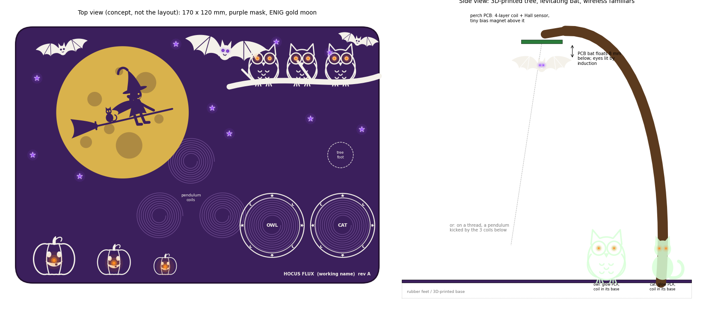

# Chat with Claude about a cute, physics-y Halloween PCB

Every prompt is recorded here as it was typed, with minor typos fixed, followed by the
response. The design files, scripts and documents in this repository are what the
responses produced. Times are US Pacific.

The working name is `halloween1` (the directory) until a better one is chosen; this log
keeps names as they were at the time.

## Prompt 1

Start a new git repo in this directory, ~/mudd/pcbs/halloween1. You should make heavy
use of my ~/OpticsPCBs/CLAUDE_PCB.md file, and in fact you should feel free to add to it
in place (other agents may also occasionally add to it.) Examples of how I'd like you to
make PCBs for me are in ~/OpticsPCBs/GPSDO-PYNQ-Z2, ~/OpticsPCBs/ECP5-2ADC-2DAC,
~/mudd/other/GPiBridge, and ~/mudd/other/ai_unleashes_chaos .

The first thing I'd like you to do is look at ~/OpticsPCBs/CLAUDE_PCB.md and also look
at ~/mudd/pcbs/halloween1/references/Hans_Rosenberg_DesignChecklist_v5.pdf. Incorporate
anything from Hans's PDF into ~/OpticsPCBs/CLAUDE_PCB.md which is not already there. Then
add a .gitignore rule for the references directory so that no copyrighted material ends
up checked in. Most of the PCBs I make are much more fancy than this, and many in the
future will be for very fast digital and RF. Not this one today, but be sure to
incorporate tips for those fancier boards into CLAUDE_PCB.md even if they are not going
to be used today.

Now for the fun part: I want to make a cute PCB for halloween. I want it to be cute
rather than scary -- owls and bats and a 6-year-old witch are all good for my daughter.
I want you to choose a selection of beautiful orange and purple LEDs and an interesting
design and sequencing. Don't make LEDs on the board blink, but instead do smooth
transitions (with PWM faster than 100 Hz to avoid annoying flickering.) The most
interesting and unique part of this is that I want you to make it interesting from an
engineering, and especially a physics perspective. Ideas off the top of my head include
making it interestingly reactive to motion and making PCB motors that can move around
neodymium magnets (bare ones, ones embedded in 3D prints that you also design, or ones
on one or more other PCBs that you design.) If we're doing coils and magnets, it might be
fun to have the second PCB powered from the first through inductive coupling, which,
let's face it, is a little spooky (in a good way).... or levitate the 2nd PCB with some
stable or stabilized control mechanism.... or do WiFi over a 2.4GHz trace antenna that
looks like a bat or owl or ghost, but that you've simulated to actually work properly.
Other interesting, physicsy ideas include some short-range radio-like thing to a second
copy of the PCB or to a second PCB with the neodymium magnets that's being floated and
moved with the PCB motors and powered through inductive coupling. Spend some real time
and effort thinking of other ideas, and put them in a table, with an estimate of
difficulty, cost, and likelihood to work on the first try.

I'd eventually like to release this as open hardware and open-source software on
https://github.com/gallicchio/halloween1 or whatever else we might think of to change
the name to in order to be more interesting and identifying.

My typical flow for this kind of thing, as you can see, is:
* to put all of these prompts and your replies into a CLAUDE_CODE_CHAT.md.
* you make a PLAN.md that gets updated.
* download any datasheets that you cannot access.
* eventually I want to upload everything to JLCPCB and have them do as much of the
  assembly as possible while consigning them as few parts as possible (even if that will
  cost a bit extra on the first round.)
* This will probably require a large amount of power, which will be new for your PCB
  designs with me, so be sure to make the traces wide enough and tell me to make the
  copper thick enough if that's a requirement. I'd prefer a high-amp 12V supply, but if
  a 15V or higher AC to DC converter would make things better, we can do that, as long
  as they are common on amazon.
* STM32 or RP processors or Lattice FPGAs are all things I'd be happy to work with, if
  they'd make the thing more awesome. ESP32s are fine if that's really the right tool for
  the job.

<!-- typos fixed in the prompt above: "eingeering" -> "engineering"; "6-year old" ->
     "6-year-old"; "even it that" -> "even if that". The repository link was typed as
     "[https://github.com/gallicchio/halloween](https://github.com/gallicchio/halloween2026)1",
     which displays as .../halloween1 but points at .../halloween2026. -->

## Response 1 2026-10-07 10:21 - 11:16 Claude Opus 5.5 Max

*Nothing is committed yet: the repository is initialised with its `.gitignore`, and
everything below is untracked until you say so. `~/OpticsPCBs/CLAUDE_PCB.md` is edited
in place and not committed there either (another agent's uncommitted edits are in it
too).*

### What was done

1. **Repository:** `git init` here (branch `main`), and a `.gitignore` that keeps
   `references/` (Hans Rosenberg's PDF), `datasheets/`, `reference/`, JLCPCB's cached
   data, simulation dumps and build scratch out of git. Checked:
   `git check-ignore references/Hans_Rosenberg_DesignChecklist_v5.pdf` names the rule.
2. **`CLAUDE_PCB.md`**, from Rosenberg's checklist (only what was not already there):
   - §1: "Think five steps ahead".
   - §4: the schematic checks:
     - one-pin nets, rail aliases, one ground;
     - clamps on inductive loads, input fuses, polarized parts, transformer dots;
     - no floating inputs, design equations asserted against netlist values,
       ratings, options where unsure.
   - §5: stack-up and layer assignment (with his via-inductance numbers), the layout
     order, then:
     - one via per ground pad, inductor coupling, aggressors and victims;
     - no floating copper, copper balance, via size;
     - assembly spacing, the paste layer, fiducials, layer markers, a 1:1 paper check.
   - §10: four new gates.
   - **New §12-16**, for the boards to come: choosing real components (capacitor
     physics, at length), fast digital, RF, power, current and magnetics (IPC-2221
     widths, hot-plug ringing, PCB coils), and boards for children. They cite sources,
     not boards, and the intro says so.
   - §8: JLCPCB facts found today (colour decides the assembly service, 2 oz rules,
     lead times, duty).
3. **Physics feasibility,** in Python with a small magnetostatics toolkit validated
   against closed forms (`sim/physics/`, README there):
   - wireless power to figurines, then the same in the time domain with real LED
     thresholds;
   - forces on magnets from PCB coils;
   - pendulum kicks, sliding and rolling;
   - levitation statics, then a closed-loop simulation of a levitating bat.
4. **Research,** by three background agents:
   - a JLCPCB parts survey with stock and prices (`research/jlc_parts_survey.md`),
     with datasheets in `datasheets/`;
   - an openEMS study of bat- and ghost-shaped 2.4 GHz antennas (`sim/antenna/`);
   - web research on JLCPCB's options and lead times, prior art, names, child safety
     and Amazon parts (`research/web_research.md`).
5. **Art:** the characters as exact geometry (`art/shapes.py`): owl, bat, pumpkin,
   ghost, cat, the witch on her broom, the moon and the perches. They drew the concept
   sketch below and will become the silkscreen, mask and gold.
6. **`PLAN.md`** (the ideas table, the recommendation, the schedule, the work list),
   `README.md`, `LICENSE` (CERN-OHL-P-2.0 and MIT, as GPiBridge), and GPiBridge's
   generic build tools copied into `tools/` and `mfg/`.

### The ideas, with difficulty, cost and first-try odds

Scales:
- **Difficulty:** 1 (an evening) to 5 (research).
- **Cost:** parts added per board, beyond the MCU, power and LEDs every version has.
- **Works first time:** the chance it works on rev A with no respin (firmware may still
  need tuning on the bench).
- **Cute** and **physics:** 1-5.

The coil and magnet rows rest on the simulations in `sim/physics/`.

#### A. Light and colour

| # | idea | the physics | diff. | cost | works first time | cute | physics |
|---|---|---|:-:|:-:|:-:|:-:|:-:|
| A1 | **The light show:** ~40-70 orange and purple LEDs on constant-current drivers with 12-16-bit PWM far above 100 Hz; perceptual (CIE L*) fades; scenes from dusk to dawn | vision (why linear fades look wrong); band gaps: orange 2.0 eV, violet 3.1 eV | 2 | $3-6 | 95 % | 5 | 2 |
| A2 | **The quantum ghost:** a wave packet evolved by the Schrödinger equation along a row of LEDs (brightness = \|ψ\|²) walks into a wall and partly tunnels through it | quantum tunnelling: ghosts walk through walls, and so do electrons | 2 | $0 | 95 % | 4 | 5 |
| A3 | **Glow-in-the-dark familiars:** violet LEDs charge figurines printed in glow PLA; they glow on after the lights fade | phosphorescence (trapped electrons in SrAl₂O₄:Eu,Dy); power-law, not exponential, decay | 1 | $0.5 + filament | 95 % | 5 | 4 |
| A4 | Secret messages in invisible (UV-marker) ink, or tonic water, revealed by violet light | fluorescence; Stokes shift | 1 | $0 | 95 % | 4 | 3 |
| A5 | **LEDs that see:** a reverse-biased LED is a photodiode for photons above its band gap. An orange LED sees violet light; a violet LED is blind to orange | photoelectric effect, band gaps | 2 | $0 | 80 % | 3 | 5 |
| A6 | Back-lit board art: light through copper-free windows in the FR4 itself; ENIG-gold moon | optics of FR4 | 2 | $0 | 90 % | 4 | 2 |
| A7 | Edge-lit engraved acrylic witch or owl standing in a slot | total internal reflection | 2 | $3-5 | 90 % | 4 | 3 |
| A8 | Pepper's ghost: a 45° clear sheet in a printed haunted house makes an LED ghost float inside | partial reflection (the Haunted Mansion's trick) | 2 | $2 | 90 % | 4 | 3 |
| A9 | A diffraction-grating window to see each LED's spectrum | diffraction; line widths | 1 | $1 | 95 % | 3 | 4 |
| A10 | Neon (orange) and argon (violet) glow lamps | atomic line spectra | 3 | $3 | 70 % | 3 | 5 |

A10 needs about 90 V: no, on a child's board.

#### B. Sensing and motion

| # | idea | the physics | diff. | cost | works first time | cute | physics |
|---|---|---|:-:|:-:|:-:|:-:|:-:|
| B1 | **Accelerometer:** tap to wake; tilt the board and glowing will-o'-wisps roll downhill; footsteps in the room wake the owls | gravity, a particle simulation; floor vibration | 2 | $1 | 95 % | 5 | 3 |
| B2 | **Owls wake at dusk** (ambient-light sensor) and sleep when the lights come on | nocturnal owls; photometry | 1 | $0.5 | 95 % | 5 | 2 |
| B3 | Owl eyes that follow you: multi-zone laser time-of-flight (8×8 zones) | photon time of flight: 1 ns = 15 cm | 3 | $5-8 | 80 % | 5 | 4 |
| B4 | An echolocating bat: 40 kHz chirps, two "ears" find direction from the arrival-time difference | sonar, speed of sound, interaural time difference (≤ 90 µs) | 3 | $2-3 | 80 % | 5 | 5 |
| B5 | Theremin ghost: your hand's capacitance detunes an oscillator; the ghost's "woo-oo" and its light follow your hand | capacitance; heterodyning | 2-3 | $2 + speaker | 85 % | 4 | 4 |
| B6 | The witch's wand: a magnet-tipped printed wand, located by 3-axis magnetometers; gestures cast spells | dipole fields, an inverse problem | 3 | $3-6 | 80 % (tracking quality 60 %) | 5 | 4 |
| B7 | **Firefly synchrony:** the jack-o'-lanterns pulse out of step, then pull into step (and between boards, by light) | coupled oscillators (Kuramoto; Mirollo-Strogatz) | 2 | $0.5 | 90 % | 4 | 5 |
| B8 | Hoot back: the owl hears "hoo-hoo" and answers | pitch detection | 3 | $2 + speaker | 75 % | 5 | 3 |
| B9 | Ghost detector: the 60 Hz electric field of the house wiring, and the microwave oven's 2.45 GHz | capacitive pickup; RF | 2 | $1 | 85 % | 5 | 4 |
| B10 | The owl oracle: yes/no answers from the avalanche noise of a reverse-biased junction | true (quantum) randomness | 2 | $0.5 | 85 % | 4 | 4 |
| B11 | The real moon: the gold moon shows tonight's phase (on Halloween 2026 a waning gibbous, about 65 % lit, six days after the full moon of the evening of 10-25 in California) | orbital mechanics (Meeus) | 2 | $0.5 | 95 % | 3 | 3 |

#### C. Coils and magnets (PCB "motors")

The numbers behind these are in `sim/physics/README.md`.

| # | idea | the physics | diff. | cost | works first time | cute | physics |
|---|---|---|:-:|:-:|:-:|:-:|:-:|
| C1 | **Wireless familiars:** an owl and a cat (printed) light up when set on their "magic circle" perches: no battery and no chip inside, just a coil, a capacitor and LEDs. Each is tuned to its own frequency, so the board lights each one separately and can tell which one is sitting where | Faraday induction, resonance, coupling; frequency-division addressing; reflected impedance | 3 | $1.5 per familiar + print | 90 % | 5 | 5 |
| C2 | **The bat that never stops flying:** a magnet bat on a thread, kept swinging by pulses from coils under it, timed from the voltage the passing magnet induces. It circles the moon (a rotating field), or wanders chaotically between three pumpkins | driven pendulum; Faraday sensing; chaos with fractal basins | 3 | $2 + printed arch | 90 % | 5 | 5 |
| C3 | **The levitating bat:** a small PCB bat floats 8 mm under a "perch" board with no visible support, eyes lit by induction. A tiny bias magnet carries its weight; a PCB coil and a Hall sensor hold it there; the coil's mean current is about zero; the H-bridge's PWM ripple lights its eyes | Earnshaw's theorem and feedback; zero-power suspension; induction. Closed-loop simulation: holds with 20 mA rms and ~1 mW in the coil, catches the bat from ±3 mm (`sim/physics/` §3b) | 4-5 | $5 + perch PCB + prints | 65 % | 5 | 5 |
| C4 | A rolling pumpkin: a magnet sphere in a printed pumpkin rolls round a coil track | torque on a dipole; rolling | 3 | $3 | 75 % | 5 | 4 |
| C5 | A sliding bat puck: a 3-phase PCB linear motor ring round the moon | Lorentz force; synchronous motors | 3-4 | $3-5 | 65 % | 4 | 4 |
| C6 | A carousel: a PCB axial-flux motor spins a printed rotor of bats round a tower | BLDC commutation, back-EMF | 3 | $3 + bearing | 85 % | 4 | 4 |
| C7 | An everlasting spinning top, kicked by a coil | gyroscopes; induction | 3 | $1 | 80 % | 4 | 4 |
| C8 | A ferrofluid potion that dances (needs tens of mT: a magnet moved by C6, not PCB coils) | magnetic fluids, the Rosensweig instability | 4 | $15 | 50 % | 4 | 5 |
| C9 | A floating graphite ghost: pyrolytic graphite levitates, unpowered, over a magnet checkerboard (moving it with light is a research project) | diamagnetism, the loophole in Earnshaw | 2 / 5 | $20-30 | 95 % / 20 % | 3 | 5 |
| C10 | Magnetic viewing film over the coils | field lines | 1 | $10 | 95 % | 2 | 3 |
| C11 | A shake-to-charge wand: a magnet sliding through a coil charges a supercapacitor that lights the tip | Faraday's law; energy storage | 3 | $3 | 75 % | 4 | 4 |
| C12 | Lenz's slow ghost: a magnet ghost drifts down a copper tube; pickup coils time its fall | eddy currents, terminal velocity | 2 | $5-10 | 90 % | 4 | 5 |

Not worth it: carrying a bat's whole weight with a PCB coil and no iron. At a 5 mm
gap that takes 0.8 A and 2.3 W; at 8 mm, 1.5 A and 7 W.

#### D. Radio

| # | idea | the physics | diff. | cost | works first time | cute | physics |
|---|---|---|:-:|:-:|:-:|:-:|:-:|
| D1 | **A bat-wing 2.4 GHz antenna** on an ESP32, simulated in openEMS (`sim/antenna/`): a phone "spell book" page; the time for the moon phase | antennas, resonance, radiation | 4 | $3-4 | see `sim/antenna/` | 3 | 5 |
| D2 | "Entangled pumpkins": two boards linked (ESP-NOW, or by light); touch one and the other answers | (networking) | 2-3 | $0-2 | 85 % | 4 | 2 |
| D3 | Data over the familiar link: amplitude modulation down, load modulation back, like Qi and NFC (needs a tiny MCU in each familiar) | near-field communication | 4 | $0.5 + programming | 70 % | 3 | 4 |
| D4 | A bat detector: an ultrasonic microphone heterodyned down to audible | heterodyning; real bats' calls | 3 | $2 + speaker | 75 % | 4 | 5 |

#### E. Heat and other

| # | idea | the physics | diff. | cost | works first time | cute | physics |
|---|---|---|:-:|:-:|:-:|:-:|:-:|
| E1 | A secret ghost: a heater trace under 31 °C thermochromic paint makes a hidden ghost appear | Joule heating, thermal diffusion | 2 | $5 | 85 % | 4 | 4 |
| E2 | A cloud chamber showing cosmic-ray "ghost trails" | muons, supersaturation | 5 | $40+ | 30 % | 3 | 5 |
| E3 | A persistence-of-vision wand that draws a ghost in the air | vision | 3 | $3 + motor | 75 % | 4 | 3 |
| E4 | A strobed "time fountain" of water drops | stroboscopy | 4 | pump | 60 % | 4 | 4 |

E2 is not for a child's room; E4 strobes, which this board does not do.

### What the physics says (`sim/physics/README.md`)

- **Familiars powered through the air are easy.**
  - A 4-layer perch coil and a 4-layer coin in the figurine's base, 3 mm apart,
    couple at k = 0.47.
  - With a parallel-resonant tank and an orange and a violet LED in anti-parallel,
    0.1-0.2 A in the perch coil fades the figurine from dark through orange to orange
    and violet. Violet needs more voltage than orange because its photons carry 3.1 eV
    against 2.0 eV: the band gap, visible on the figurine.
  - Owl tuned to 150 kHz and cat to 330 kHz: below 0.2 A the other one stays
    completely dark, because the LED threshold does the isolating. So the board lights
    each familiar separately, and can tell which one is sitting where from the
    reflected impedance, **with no chip in the figurine**.
- **A pendulum bat is easy.** One 1 A pulse does about 330 µJ of work on a magnet
  passing 10 mm over a coil; air takes about 70 µJ a swing, so pulses of 0.1-0.3 A
  keep it flying. Timing them from the voltage the passing magnet induces in the coil
  does not work here: by reciprocity it is the force per amp times the speed, only
  about 3 mV with 48 turns, where classic kickers have about 1500. So a 3-axis Hall
  sensor under the swing times the kicks, and the back-EMF is a bonus measurement.
- **A PCB coil alone cannot carry a bat's weight** without cooking: 2.3 W at a 5 mm
  gap, 7 W at 8 mm.
- **With a tiny bias magnet it can levitate one.**
  - Statics: a 4 × 1 mm magnet above the perch carries a 2.7 g PCB bat at 8.4 mm.
    Sideways is stable (+3.2 N/m); vertically it is unstable (6.4 N/m), but the coil
    grips it at 22 mN/A, and the Hall sensor sees 9 mT per mm of gap.
  - Closed loop, simulated in time with sensor noise, ADC quantisation and the
    bridge's limits:
    - it holds with 20 mA rms and about 1 mW in the coil (the mean current settles
      at 1 mA: zero-power suspension);
    - it catches the bat released anywhere within ±3 mm, with peaks of 1.6-2.4 A;
    - the first tuning I tried was too hot (0.6 A of chatter from sensor noise
      through the derivative), and averaging the ADC and a 10 Hz loop fixed it.
- **Magnets roll easily, slide less easily.** A 10 mm magnet sphere needs only tens of
  mA to roll. A disc sliding on a cover gets 68 mN/A against 10 mN of friction, but
  tips over above about 0.5 A.

### My recommendation for rev A

One base board and three small boards, **all on one JLCPCB panel** (purple mask on a
4-layer assembled board needs JLCPCB's Standard PCBA, whose smallest board is 70 × 70
mm, so the small ones ride as break-away tabs):

1. **The base board** (about 170 × 120 mm, 4 layers, purple mask, white silk, ENIG):
   - a gold moon with the little witch and her cat flying across it, owls on a branch
     with LED eyes, bats, violet stars, friendly pumpkins whose faces glow;
   - two "magic circle" perches for the familiars (5 V gate-driver bridges), three
     pendulum coils (12 V DRV8874s with current sense), the planes cleared under every
     coil, and a 3-axis Hall sensor under the swing;
   - an accelerometer, a light sensor, an RP2354A, USB-C, and 12 V input.
2. **The perch board:** the levitation coil, a Hall sensor and a bias-magnet pocket,
   hung from a 3D-printed tree on a cable to the base board.
3. **The bat:** a small purple PCB with its receive coil and violet LED eyes, and its
   magnet sealed in a printed body. It levitates under the perch; if levitation needs
   more tuning than Halloween allows, it swings on a thread over the pendulum coils
   instead. Same bat, same tree.
4. **Familiar coins:** coil, capacitor, an orange and a violet LED and their
   resistors, sealed in the bases of a printed owl and cat in glow-in-the-dark PLA
   (the violet light charges them, so they glow on after the light fades).

**Why this set:**
- The two things most likely to delight a six-year-old (figures that light up with
  nothing attached, and a bat that flies or floats on its own) are also the two with
  the deepest physics (induction, resonance, Earnshaw's theorem, feedback, chaos).
- The familiars and the pendulum are each about 90 % first-time. The levitation is the
  stretch (65 %), and it fails safe into the pendulum.
- Everything risky is an option that costs only time if it fails.

**Not in rev A** (rev B, unless you want them now):
- WiFi with the bat antenna (results below);
- owl eyes that follow you (time-of-flight);
- an echolocating bat (ultrasound).

### The light show

Nothing ever blinks. Every change is a fade of at least 300 ms, computed at about 200
frames/s, shown through constant-current PWM at tens of kHz (no flicker for eyes or
phone cameras), and mapped through CIE L* so the fade looks even.

- **Asleep** (room lights on): the pumpkins breathe slowly and dimly.
- **Dusk** (the room goes dark, or a tap): violet stars fade in one by one over 30 s,
  and the owls' eyes open slowly.
- **Night:**
  - the pumpkins glow like candles (smooth 1/f noise, never a blink), and the stars
    scintillate gently;
  - the owls look left and right;
  - purple will-o'-wisps drift, and roll downhill when the board is tilted.
- **Firefly synchrony,** every few minutes: the jack-o'-lanterns pulse out of step,
  then pull into step over a minute (Kuramoto coupling), and drift apart again.
- **The quantum ghost** (a double tap): a wave packet runs along the stars, meets a
  wall, and partly tunnels through.
- **A familiar arrives:** the perch finds its resonance, and its eyes fade up in the
  board's colours.
- **Dawn:** the reverse of dusk; the owls close their eyes.

### Microcontroller: RP2354A

- **Reuse:** GPiBridge's copy of Raspberry Pi's RP2350 regulator layout, its Pico SDK
  firmware structure, its tools and its rotation predictions all carry over (and
  GPiBridge's boards, already ordered, will test that copper first).
- **The jobs:** twelve PWM slices drive the bridges at any frequency to 400 kHz, and
  PIO is there if needed. Two Cortex-M33 cores with floating point run the light
  show's physics (Schrödinger, Kuramoto, particles) and a 10 kHz levitation loop.
- **Pins:** 30 GPIO is enough with an analog multiplexer for the current senses
  (about 27 used).
- **Not an ESP32:** no rev A feature needs WiFi; if the bat antenna goes on, it should
  be an ESP32-C3 radio beside the RP2354A.
- **Not an STM32G4:** its HRTIM is nicer for resonant drives, but it would mean a new
  toolchain and pipeline for no feature that needs it.
- **Not an FPGA:** nothing here needs one.

### Power, and the copper to order

- **Supply:** a common **12 V, 3-5 A** brick (5.5 × 2.1 mm, centre positive,
  UL-listed). Typical draw is about 5 W, the worst case about 15 W; 15 V or more
  would help nothing.
- **Input protection:** reverse polarity, a fuse, a TVS, and a bulk electrolytic to
  damp hot-plug ringing (a 12 V brick on a cable can ring to 24 V at plug-in).
- **Copper:**
  - **1 oz outer is enough.** The 12 V and ground run in pours, and 3 A needs only a
    1.4 mm track for a 10 °C rise.
  - **Order 1 oz inner copper** if JLCPCB offers it on the standard stack-up (its
    default is 0.5 oz). It takes the canonical coil from 3.35 Ω to 2.2 Ω, which
    matters for coil heating.
  - 2 oz outer is not needed: it costs extra and coarsens the minimum track and gap
    for the whole board.

### The calendar

Halloween is Saturday 10-31. A 4-layer board takes 2-5 days at JLCPCB, assembly at
least 4 more, UPS Express Saver 4-5 business days to California (DHL and FedEx
Express are now for corporate accounts only), and parts not in stock add 9-15 days.
So:
- **order by Monday 10-12 to Wednesday 10-14**, with in-stock parts only;
- that leaves about five to seven days of design;
- the levitation and familiar firmware gets written while the boards are in the post.

**Rough cost** for 5 boards, 3 assembled, with ENIG, purple, UPS and 35 % duty:
**$300-450**. The real BOM will tighten this.

### The LEDs, and the parts that matter (JLCPCB stock on 2026-10-07)

**The LEDs** (from about 60 candidates):
- **Pumpkin orange:** XINGLIGHT XL-1608UOC-06, 0603, 600-610 nm (C965800, 399k in
  stock) for eyes and small glows; a three-die 5050 (HL-AF-5060S22OC, C516304) behind
  the pumpkins' faces.
- **Violet:** a 400-410 nm 3528 (C516136, 68k) for the stars. Violet looks deep and
  magical, and it makes glow-in-the-dark and fluorescent things light up. 405 rather
  than 395 nm, for the eyes' sake.
- **Visible purple:** a phosphor "purple" 0603 (GL0603PU01, C51933300), because the
  eye barely sees 405 nm (0.04 % of its sensitivity at 555 nm).
- No orange or purple LED is a JLCPCB Basic part, so each colour costs a $3 setup fee.

**The drivers that make "never blinks" true:**
- **Two TI LP5036** (C701961, 17k): 36 constant-current channels each, 12-bit PWM at
  29 kHz, and a logarithmic dimming curve built in. Temporal dithering at the 200 fps
  frame rate adds the last bits for the deepest fades.
- Ruled out:
  - the 16-bit ISSI parts I hoped for (IS31FL3237: 12 in stock);
  - the TLC5947 (PWM ~1 kHz) and PCA9685 (not constant-current, ≤1.5 kHz);
  - WS2816 RGB pixels (they would mix orange and purple from RGB, not be them).

**Coil drivers** (from the datasheets, because stock is not the whole story):
- **Pendulum coils and the levitation perch: TI DRV8874** (C1855818, 29k), with 6 A
  peaks and built-in current sense. Its PWM stops at 100 kHz, which is fine for these.
- **The familiar perches need 150-330 kHz:**
  - The integrated bridges stop at 100-200 kHz, the 500 kHz DRV8412 has only 264 in
    stock, and one builder's cheap bridge gave 56 mA at 260 kHz against 360 mA at
    5 kHz.
  - So each perch gets a **UCC27524** dual gate driver (C465729, 62k; 7 ns edges)
    used as a full bridge, **from 5 V**.
  - At 5 V the perch coil's own reactance caps the current at 0.24 A (150 kHz) and
    0.11 A (330 kHz). That keeps every familiar LED in its rating whatever the firmware
    does, which series resistors alone could not (`familiar_resistors.py`).

**12 V input:** a 5 A barrel jack, an eFuse, an SMBJ15A TVS and a 470 µF polymer
bulk capacitor. **Bucks:** TPS54302 (12 → 5 V, 3 A), then 3.3 V.

**Sensors:**
- an accelerometer (LIS2DW12 or LSM6DS3);
- an LTR-303 light sensor;
- a TMAG5273 3-axis Hall sensor under the pendulum;
- a DRV5055 linear Hall sensor on the perch.

The full survey, with alternates and the datasheets fetched (69, in the ignored
`datasheets/`), is in `research/jlc_parts_survey.md`.

### The bat antenna (openEMS; preliminary, the study is still running)

A background agent is simulating character-shaped 2.4 GHz antennas in openEMS on
JLCPCB FR4 (`sim/antenna/`; its full write-up, with efficiency, pattern, sensitivity
and the matching plan, will land in `sim/antenna/README.md`).

**Validation first:**
- a plain half-wave dipole resonates at 2.415 GHz with 72 Ω (the textbook value is
  about 73 Ω);
- TI's DN007 reference inverted-F, on a realistic ground plane, resonates at 2.38 GHz
  at −27 dB.

**Then the characters:**

| antenna | resonance | best S11 | worst S11 across 2.400-2.484 GHz |
|---|---:|---:|---:|
| bat-wing dipole (each wing one arm), 40 mm span | 2.74 GHz | −38 dB | −5 dB (tuned too high) |
| **bat-wing dipole, 46 mm span** | **2.39 GHz** | **−32 dB** | **−17 dB: the whole band** |
| bat-wing dipole, 52 mm span | 2.16 GHz | −25 dB | −11 dB |
| ghost-shaped planar monopole, R = 8 mm | 1.92 GHz | −15 dB | −11 dB (broadband) |
| bat as an inverted-F (feet = feed and short) | none in band yet | −4 dB | still being tuned |

**So "a bat that is really a working WiFi antenna" is real.**
- The wings are a dipole whose length sets the frequency: 46 mm of wingspan lands it
  on the band, with margin.
- A dipole is balanced and the ESP32's RF port is not, so it needs a small balun or a
  printed one. The single-ended ghost needs none.

**My recommendation stays rev B for the radio:** it brings a second processor (an
ESP32-C3FH4, 5.7k in stock) and its RF layout into a week that is already full. If you
want it in rev A anyway, it is an add-on block at the board's edge that changes nothing
else.

### The name

Checked on GitHub, the web and Trademarkia (a quick look, not a legal clearance).

**My pick is Hocus Flux:** hocus-pocus, plus magnetic flux (the Φ in Faraday's law,
which powers everything on the board), plus solder flux. Nothing by that name turned
up. "Flux" is also an AI PCB-design company (flux.ai), which an AI-designed board can
wear as a wink.

The alternatives:
- **Owlternating Current:** zero hits anywhere.
- **Faraday's Familiars:** free as a phrase. Bare "Familiar" is a pending trademark
  for robot pets (Familiar Machines & Magic, launched in May 2026), so it would need to
  keep the "Faraday's".
- **Maxwell's Witch**, **Hoot Induction**, **Jack-o'-Lenz:** all free.
- **Spooky Action at a Distance** is perfect physics but crowded: 21 repositories, and
  nearby trademarks.

`github.com/gallicchio/halloween1` (and `/halloween2026`, `/halloween`) does not
exist yet, so any of these is open. The board's name lives in one place,
`gen/board_info.py`, and the silkscreen will read it from there.

### Safety, for a six-year-old (now `CLAUDE_PCB.md` §16)

- **Magnets:**
  - Under the toy standard (ASTM F963), every neodymium magnet here, even a 2 × 1 mm
    disc, is a "hazardous magnet".
  - Each must stay captive through soaking, drops, twisting, a 15 lbf pull and a
    30 lbf squeeze.
  - So every magnet is printed in (pause the print, drop it in, print over it), never
    glued into a pocket.
- **Violet LEDs:** 405 nm rather than 395 nm (395 looks dim, so the blink reflex does
  not protect), at low current and diffused.
- **Heat:** every coil's duty is capped in firmware, with a temperature sensor beside
  the coils.
- **Board:** rounded corners, a fuse, and a UL-listed adapter.

### What I need from you

1. **The features:** the recommended set above, or changes.
2. **The name.**
3. **Your daughter's name on the board?** For example "made for ___, Halloween 2026" on
   the back, which will carry a "spell book" of the physics: Faraday's law by the
   perches, Earnshaw's theorem by the perch port, E = hc/λ by the LEDs, Schrödinger by
   the stars and Kuramoto by the pumpkins.
4. **3D printing:** do you have a printer here? JLC3DP has no glow-in-the-dark
   material, so the familiars want home printing; the tree and bodies could go either
   way.
5. **On the order:** confirm purple mask, ENIG, and 1 oz inner copper.

### How rev A is most likely to fail, so far

1. **The levitation needs more tuning than the week before Halloween allows.** Then
   the bat hangs on a thread as the pendulum. Same bat, same tree.
2. **A familiar's resonance lands off frequency** (coil and capacitor tolerances, or a
   printed floor of a different thickness). The board sweeps the frequency and locks
   on to the peak; the tuning capacitors get a second, empty footprint in parallel.
3. **A coil runs hot,** or a familiar's LEDs are overdriven, if firmware misbehaves.
   Mitigations: current limits in the bridges, duty limits in firmware, and a
   temperature sensor. The familiar perches run from 5 V, where the coil's own
   reactance caps the drive.
4. **The schedule:** a JLCPCB engineering hold or a part going out of stock. Use only
   deep-stock parts, answer JLCPCB within hours, and pick an alternate for every
   Extended part.
5. **A placement turned by JLCPCB.** Rotations are predicted from JLCPCB's own
   drawings, as on GPiBridge, where every prediction was right.

## Prompt 2

I like C1, C2, and C3 best. Adding a B5 Theremin would be fun, as long as the speaker can
be switched off.

My daughter already has Magnetic viewing film (C10), which she loves, but has only used
it over permanent magnets. If something interesting and visible changes when she puts it
over the coils here, that would be fun. If there is a simple, low-cost way to make this
happen, that would be nice, but not required.

I like "Owlternating Current" best, since my daughter wants to be an owl for Halloween.
Maybe try a different capitalization or hyphenation, like "OWLternating Current" or
"Owl-ternating Current" to make it easier to read. All three of these are equally
appealing to me at the moment, but I could be persuaded in either direction. Yes, the
name on the back with the "spell book" of the equations! I do have a 3D printer. You'll
need to start a list of exactly what I need to order once the PCB order is placed
(specifics of the magnets, 3D printer filament.) Yes to the purple mask, ENIG. If 1 oz
inner copper is right for this design, that's fine.

In general, minimize the "extra steps" that I need to do beyond uploading the JLCPCB
order, even if this makes it slightly more expensive. This includes 3D printing, ordering
additional things, gluing on magnets, etc. Some minimum amount of this is required to
make the project happen, but the more steps there are (especially if they depend on each
other), the less likely it will be finished by Halloween.

Add this prompt to the CHAT document as the next prompt and keep going. Take the design
all the way to an order list, a 3D printer file, and the JLCPCB. Then write a design
review document that I'll ask other LLMs to look at.

<!-- typos fixed in the prompt above: "Yes. the name" -> "Yes, the name"; "halloween" ->
     "Halloween". -->

## Response 2 2026-10-07 12:13 - (in progress) Claude Opus 5.5 Max

*(being written; progress is logged below as the work goes)*

### Progress log

- **12:13** Prompt recorded. Committing as I go from now on (you: "Commit as you go").
- **12:20** Two lessons into `CLAUDE_PCB.md` §1: minimise the steps beyond the JLCPCB
  upload, and commit as you go in a repository that is mine alone.
- **12:35** New parts: a real 23 mm speaker with PCB pins (GSPK2307P, 5k in stock), the
  NS4150B amplifier, the MSK12C02 sound switch, 2 × 8 right-angle headers and sockets
  for the plug-together tree, orange side-view LEDs for the bat's eyes.
- **12:50** One magnet size for everything: the bias magnet is the bat's own 10 × 2 mm
  disc, 14 mm above the perch, and the 3.6 g bat floats 8.5 mm below
  (`sim/physics/levitation_onemagnet.py`). The bat's eyes are lit by a 90 kHz carrier
  in the levitation coil: ~9 mA each (`bat_power.py`). The familiar tokens, lying flat
  on their perches, get 15-23 mA through 150 Ω at the 5 V drive's hard cap.
- **13:05** Datasheet checks that changed the design:
  - the UCC27524's continuous output limit is 0.3 A, so each perch leg gets a whole
    chip, channels in parallel;
  - the TMAG5273A2 answers at 0x35, not 0x22.
- **13:15** The antenna study finished (for rev B): a ghost-shaped monopole needs no
  matching parts.
- **13:20** Interfaces fixed and committed: `gen/pins.py` (all 30 GPIOs within the 8
  PWM slices), `gen/mech.py`, `gen/leds.py` (49 LEDs). Two agents started: the 3D
  prints (`print/`) and the firmware (`firmware/`).
- **13:57** The base's schematic (A1): power, the RP2354A on GPiBridge's corner, both
  LED drivers' sheets, sensors, four coil bridges, two perch bridges, mux, theremin,
  audio. ERC clean, and a netlist check (200 checks) against `gen/pins.py` and
  `gen/leds.py`. Datasheet reads changed it: the AMS1117 is not stable on ceramics
  (XC6206 instead); the NS4150B's 5.25 V maximum made the "5 V" rail 4.8 V.
- **14:15** The other five boards' schematics; a ×20.6 amplifier on each perch's
  supply current, after the firmware's simulation showed 0.5 V/A could not see a token.
- **14:30** The 3D prints: one plate, one pause for both magnets, slicer-checked on
  four Bambu printers (`print/README.md`).
- **14:50** Every one of 265 parts placed on six boards, from a table by each part's
  role, so renumbering moves nothing.
- **15:10** Three agents finished: the JLCPCB release tooling (`mfg/make_release.py`:
  it caught the pumpkin LEDs wired backwards and the slide switch's posts 0.3 mm off
  JLCPCB's drawing); the coils as generated footprints whose copper is the spiral; the
  art and the spell book (`gen/art.py`).
- **15:57** Pins bound from the board (your suggestion: river routing, binding each pin
  where the river from the chip meets the river to it). `gen/assign.py`: LED driver
  crossings 115 → 0 and 42 → 0, mux 6 → 0; the RP2354A's 132 → 84, most of those forced
  by which way the chip faces. The insight went into `CLAUDE_PCB.md` §5. The firmware's
  ADC code assumed ADC0-2; with HALL now on ADC1 its host test caught it.
- **16:29** The panel brought inside JLCPCB's 250 × 250 mm for assembly (it was 323.6
  mm long): 245.2 × 223.2 mm, the tree turned 90°, 24 tabs found automatically,
  fiducials and tooling holes on the rails. The art on every board.
- **17:30** Routing: the planned copper (the RP2354A's corner, the 12 V entry, the
  buck's power loop) is in; the router still leaves nets unjoined on the base and the
  tree. Fixing the router (it gave up a whole net at its first blocked piece) and
  speeding it up.
- **2026-10-08** Routing finished. What it took:
  - **Planned fan-outs** for the RP2354A, both LED drivers and the IMU: each signal pin a
    stub and a straight line to a via of its own, the vias of a side in an evenly spaced
    row, so the lines spread like a fan. Left to the router, the first lines hugged the
    chip and walled the later pins in (37 nets unjoined).
  - **A grid bug:** a "radius 0" query (a line's centre) only checked grid points it hit
    exactly, so planned lines at an angle overlapped (53 shorts in DRC). Planned lines are
    now checked with exact geometry.
  - **Placement fixes the fan-out's reports asked for:** capacitors that stood straight
    in front of signal pins moved between them or to the ends of the row, the 1.1 V test
    point past the fan, the crystal's two lines drawn by hand.
  - **Rip-up and reroute:** a walled-in net's neighbours come out and go back after it;
    kept only if fewer nets fail.
  - **A prune** of vias and stubs the routing did not need (82).
  - **Rules:** 0.15 mm clearance on every net class (12 V needs 0.1 by IPC-2221).
  DRC: 0 violations, 0 unconnected, 0 parity. The release is written (DRAFT until her
  name is set), about $348 + ~$122 duty. `DESIGN_REVIEW.md` is ready for other reviewers.
- **2026-10-23** JLCPCB asked whether LS1 (the GSPK2307P speaker, through-hole) is the
  right way round on their 3D render (`mfg/jlcpcb_order/2026-10-23_question_about_LS1.png`).
  - Checked against the board file: LS1 at rotation 0, pad 1 (square, left, -5 mm) on the
    NS4150B's VOP, pad 2 (right) on VON.
  - The datasheet's photo (page 5) shows the speaker's two pins marked '+' and '-'.
  - JLCPCB's render puts the '+' and pin-1 dot on the left pin. They match: correct,
    proceed. Reversed it would only invert the acoustic phase anyway.
  - Recorded in `mfg/jlcpcb_order/README.md`. `mfg/jlc_rotation.py` now marks C530531's
    correction of 0 as "read".
