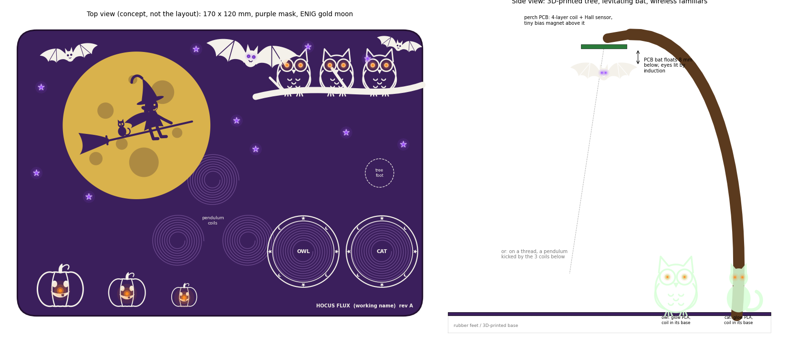

# OWLternating Current

*By Jason Gallicchio and Claude. A cute, physics-y Halloween board for a six-year-old
witch: owls, bats and a little witch on her broom across a gold moon, in orange and
purple light that fades but never blinks, with magnets and coils doing things that look
like magic.*

**Status (2026-10-07): ideas and physics.** Nothing is drawn in KiCad yet. The
recommendation waiting for Jason's choice is:
- **Familiars:** printed owl and cat figurines that light up on their "magic circle"
  perches, powered through the air, each tuned to its own frequency.
- **A bat that flies or floats by itself:** a pendulum kept swinging by PCB coils, or
  levitated under a perch board with a Hall sensor and feedback.
- **Senses and show:** a board that wakes at dusk and reacts to taps and tilts, with a
  light show that includes a quantum-tunnelling ghost and fireflies that synchronise.

| path | what |
|---|---|
| [`PLAN.md`](PLAN.md) | the ideas table (41 ideas, with difficulty, cost and first-try odds), the recommendation, the schedule, the work list |
| [`CLAUDE_CODE_CHAT.md`](CLAUDE_CODE_CHAT.md) | the conversation that designs it, every prompt and response |
| [`sim/physics/`](sim/physics/README.md) | magnetostatics and circuit simulations: wireless power, pendulum kicks, levitation, sliding and rolling magnets |
| [`sim/antenna/`](sim/antenna/) | an openEMS study of a bat-shaped 2.4 GHz antenna |
| `art/` | the characters as exact geometry, used for the sketches now and the board's silkscreen, mask and gold later |
| `research/` | the JLCPCB parts survey (stock and prices with timestamps) and the web research notes |
| `tools/`, `mfg/`, `gen/` | the build tooling, reused from GPiBridge |

Licence: hardware CERN-OHL-P-2.0, software MIT (`LICENSE`).
