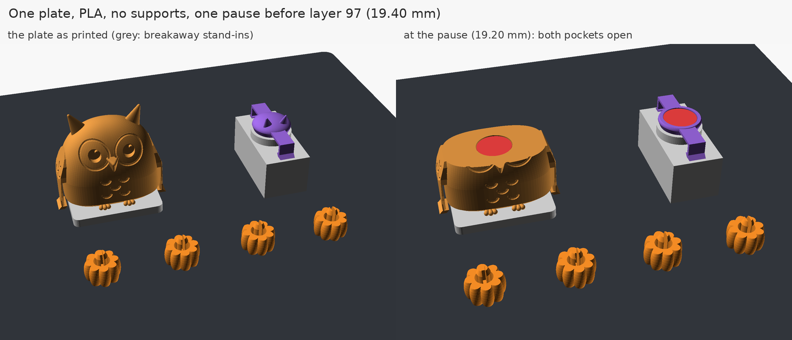
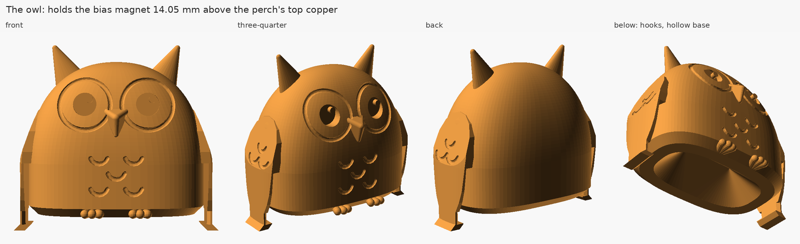
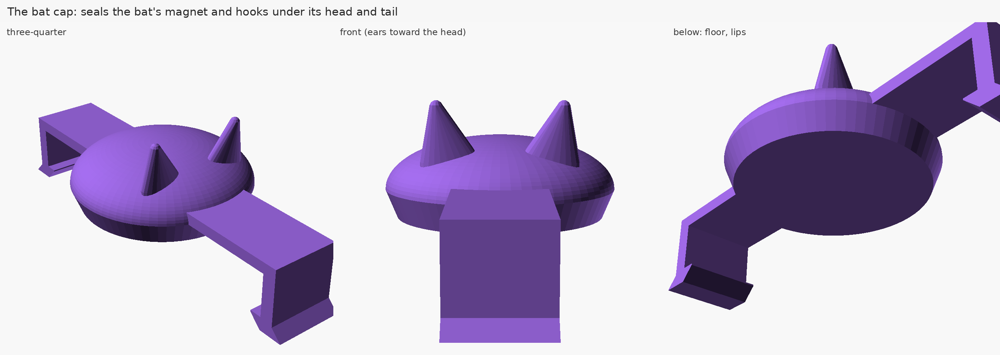
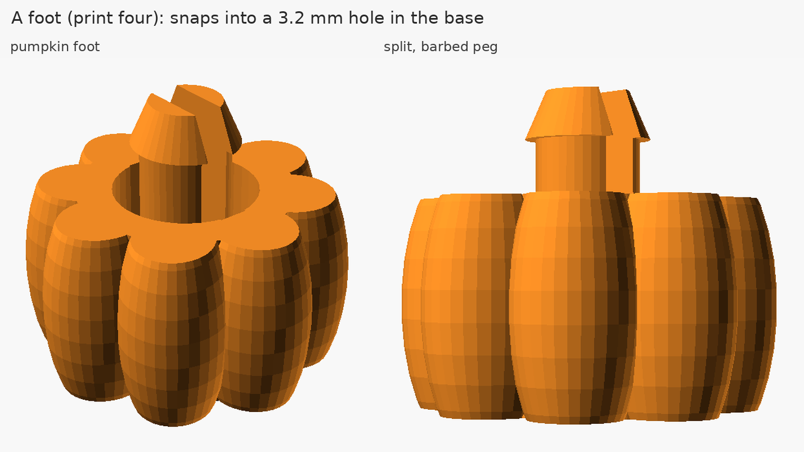
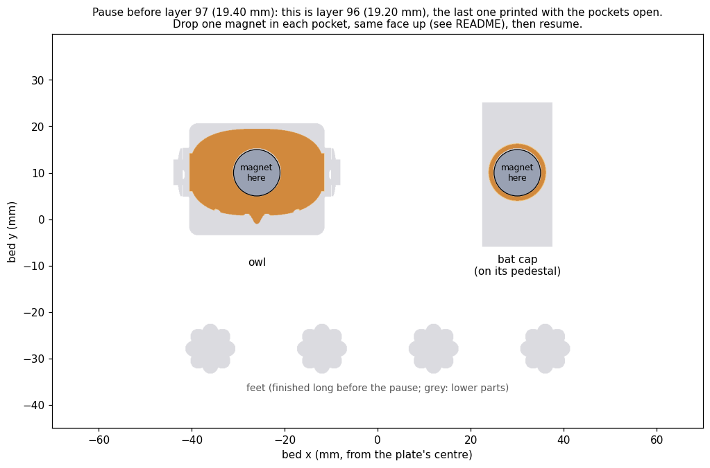
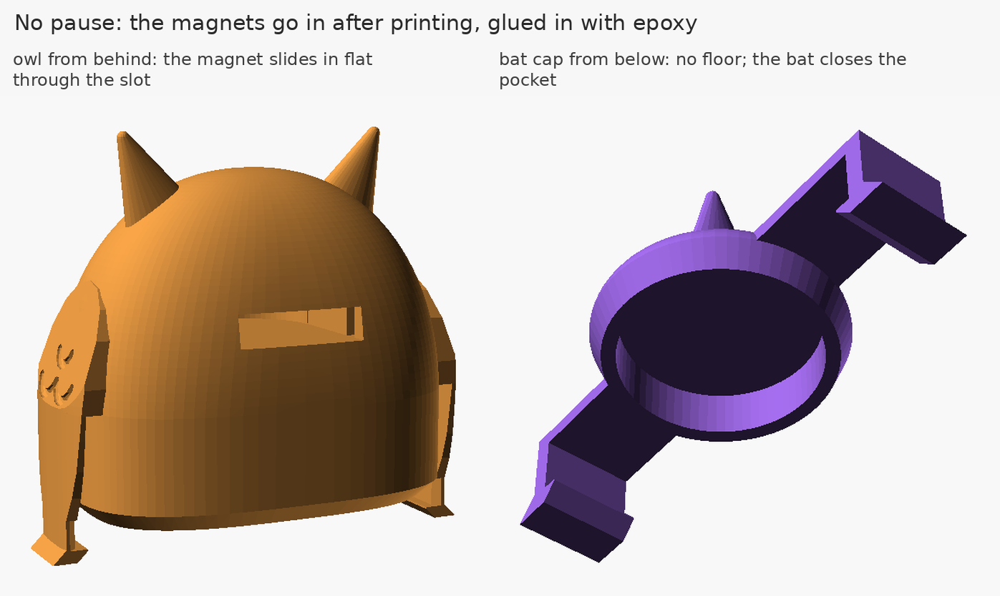
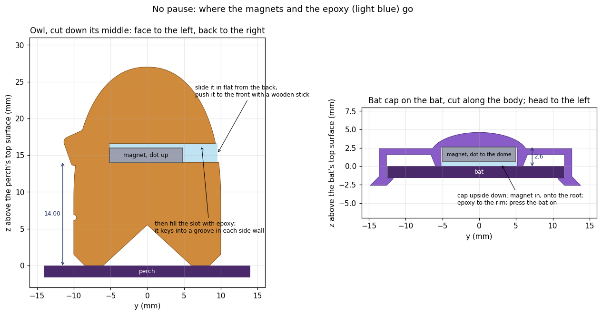
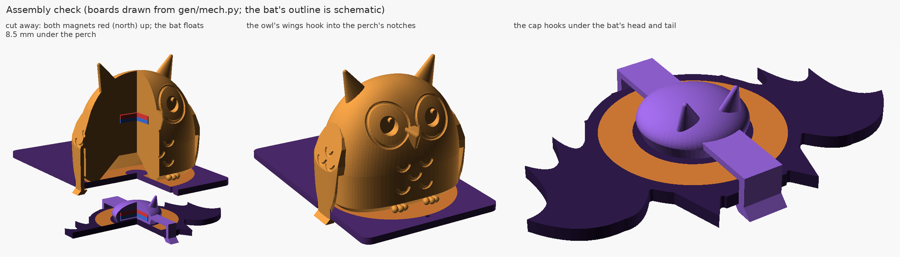
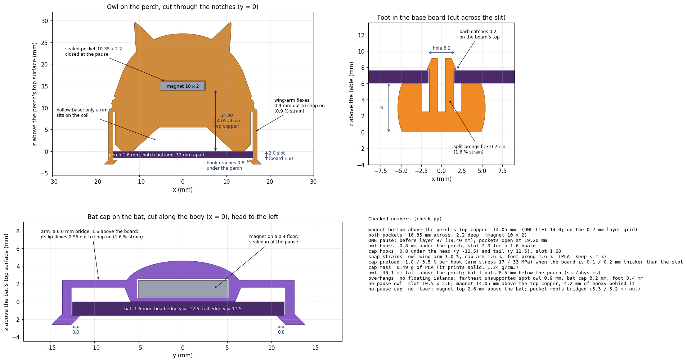

# The printed parts: an owl, the bat's cap, four feet

One plate, PLA, no supports, no glue, **one pause** for both magnets. Or no pause at all, with the magnets glued in afterwards: [the no-pause version](#the-no-pause-version-glue-the-magnets-in-afterwards).



| part | what it does |
|---|---|
| **Owl** | Snaps onto the perch over the levitation coil. Holds the bias magnet with its bottom face **14.05 mm above the perch's top copper** (`OWL_LIFT` = 14.0; the 0.2 mm layers set the 0.05). Its wings come down the perch's sides into the two notches and hook 0.8 mm under the board, so it can't slide or tip. Its hollow base touches the coil only with a 2.5 mm rim. |
| **Bat cap** | The floating bat's round, eared body. Seals the bat's magnet onto the bat's top over the receive coil, and hooks 0.8 mm under the bat's head and tail edges. No holes in the bat. 0.50 g. |
| **Four feet** | Little pumpkins that snap into the base board's corner holes from below and lift it 6 mm, clear of the through-hole pins. |
| **Two grey stand-ins** | A slab under the owl and a pedestal under the cap: throw-away. They stand where the perch and the bat will be, so the parts' undersides can print upright with nothing to support them but the stand-ins. The pedestal also lifts the cap so that **both magnet pockets close on the same layer**: one pause, not two. |





## What you need

- About 13 g of PLA, any colour.
- Two 10 × 2 mm N52 disc magnets from the pack on the order list, and a felt-tip pen.
- A little masking tape, only if your nozzle is magnetic (see "Before you print").

## Files (`out/`)

| file | use it for |
|---|---|
| `plate_bambu.3mf` | **Bambu Studio: the pause is already set.** A project saved for an X1 Carbon, 0.20 mm Standard, Bambu PLA Basic; pick your own printer and filament, and the pause stays. |
| `plate.3mf` | Any slicer: the same six objects, already placed. You add the pause. |
| `plate.stl` | The whole plate as one STL. |
| `owl.stl`, `bat_cap.stl`, `foot.stl` | One part each, with its stand-in, for a reprint. The owl and the cap still pause before layer 97. |
| `assembled/*.stl` | The bare owl and cap in their boards' coordinates, for checking them against the boards. |
| `no_pause/` | The same plate with **no pause**: `plate_bambu.3mf`, `plate.3mf`, `plate.stl`, `owl.stl`, `bat_cap.stl`. The magnets go in after printing ([below](#the-no-pause-version-glue-the-magnets-in-afterwards)). |
| `*.png` | The pictures here. |

## Print settings

- PLA, 0.4 mm nozzle, **0.2 mm layers with a 0.2 mm first layer** (the pause layer depends on it), 2 walls, 15 % infill, **supports off**, no brim. Bambu's "0.20mm Standard" is exactly this.
- Leave the parts the way they load: everything prints standing up, the way it is used. Don't use auto-orient. Arranging is fine as long as **the owl and the bat cap stay at least 4 cm apart** (their magnets would tug at each other in their pockets; as placed they are 56 mm apart).
- Bambu Studio warns: *"It seems object owl ... has floating cantilever. Please re-orient the object or enable support generation"*, and the same for the bat cap. **Ignore it; don't enable supports.** The owl's base and the cap's floor sit one layer above their grey stand-ins, the same 0.2 mm gap Bambu leaves above its own supports.
- Bambu Studio 2.8 estimates 32 min on an X1C or P1S, 37 min on an A1 or A1 mini, 12.9 g. The pause comes about 26-30 minutes in, about 80 % of the way.

## Before you print: is your nozzle magnetic?

Touch a magnet to the cold nozzle. A hardened-steel nozzle (stock on the X1C, X1E and H2D) grabs it; brass and the stainless ones on the P1S and A1 don't. A magnetic nozzle pulls a 10 × 2 mm magnet up with several times its weight from anywhere within a few millimetres, so as the first layer goes over it the magnet would jump up and rattle in its pocket. On those printers you tape the magnets down at the pause (step 5 below).

## The pause, step by step

**Bambu Studio, with `plate_bambu.3mf` (the pause is already in):**

1. *File → Open Project* and choose `out/plate_bambu.3mf`. If your printer isn't an X1 Carbon, choose yours in the printer list, and your PLA.
2. *Slice plate.* In the preview, the layer slider shows a custom G-code mark at **layer 97 (19.40 mm)**. That is the pause. It lifts the nozzle 15 mm out of the way, then waits.
3. Print.

Orca Slicer should open `plate_bambu.3mf` the same way, but I haven't tested it: look for the mark at layer 97.

**Through 3DPrinterOS (the plan: we expect to print on a Bambu Lab X1 Carbon this way):**

3DPrinterOS doesn't slice for Bambu printers; it sends a job you sliced in Bambu Studio. The pause is a line in that sliced G-code, so it goes through untouched.

1. Do steps 1-2 above in Bambu Studio: open `plate_bambu.3mf`, keep the X1 Carbon, *Slice plate*, and check for the mark at layer 97.
2. *File → Export → Export plate sliced file* to get a `.gcode.3mf`. (Plain `.3mf` or `.stl` won't do: those would be sliced again, without the pause.)
3. At cloud.3dprinteros.com, *Add file*, choose the `.gcode.3mf` and the X1 Carbon, and print. The printer needs its SD card in.
4. At the pause, resume from the **printer's touchscreen**. The X1 Carbon's stock nozzle is hardened steel, which is magnetic: **do the tape step** (step 5 under "At the pause").

**Bambu Studio, adding the pause yourself (with `plate.3mf`):**

1. Open `out/plate.3mf` (drag it in, or *File → Import*), choose printer, PLA and "0.20mm Standard", and *Slice plate*.
2. In the preview, drag the top handle of the vertical layer slider to **layer 97, 19.40 mm**: the first layer that bridges over the two round pockets. (At layer 96, 19.20 mm, both pockets are open: the picture below.)
3. **Right-click the "+"** beside the handle and choose **Add Custom G-code**. Paste these four lines, which lift the nozzle 15 mm and then pause (the same pause `plate_bambu.3mf` carries), and print:
   ```
   G91
   G1 Z15 F900
   G90
   M400 U1
   ```
   *Add Pause* also works, but it leaves the hot nozzle resting on the print where the layer ended. If that's over a pocket, the magnet won't go in.

**PrusaSlicer:**

1. Open `out/plate.3mf`, choose your printer, PLA and a 0.20 mm print profile (supports: none), and *Slice now*.
2. Drag the vertical slider to **19.40 mm** (layer 97).
3. **Right-click** the orange "+" and choose **Add pause print (M601)**. A plain left-click adds a colour change (M600), which you don't want. Export or print.
4. On a Prusa, M601 parks the head and beeps. Other firmware has its own pause command (Klipper: `PAUSE`); use that instead.

**Any other slicer:** pause **after the layer that ends at 19.20 mm, before the layer that ends at 19.40 mm** (layer 97, counting the first layer as 1).



**At the pause** (the printer beeps and shows *paused*; bed and nozzle stay hot):

1. Put the stack of magnets on the table. Mark a dot on the top face of the top magnet, then **slide it off sideways without turning it over**. Mark the new top magnet the same way and slide it off too. **Put the rest of the stack well away** (half a metre): it would pull the magnets back out of their pockets.
2. Drop one magnet, **dot up**, into the bat cap's pocket. That's the round hole on top of the small purple part on its tall grey pedestal.
3. Drop the other, **dot up**, into the owl's pocket: the round hole in the middle of the half-printed owl.
4. Check that both lie flat, both dots up.
5. *(Magnetic nozzle only.)* Stick a **narrow strip** of masking tape (about 3 mm wide, 12-13 mm long) across each magnet, its two ends pressed onto the plastic rim round the pocket. It holds the magnet down while the nozzle passes over, and the next layers seal it in. Keep it narrow: the cap's rim is only 1 mm wide, and its roof must still bond to most of it.
6. Resume from the printer's screen. The next layer closes over both magnets for good.

**Why "same face up" gets the polarity right.** Magnets stuck together in a stack all point the same way. Take the top two off the stack without flipping them and put each in its pocket with the same face up, and they point the same way. The owl and the cap both print the way they are used (owl standing, cap dome up). So on the board the owl's magnet and the bat's magnet point the same way, and **the bat is pulled up toward the owl**. In the cut-away below, both magnets are red side up. If a bat is ever pushed *away* from the owl, one magnet went in upside down; reprint that part.

## The no-pause version: glue the magnets in afterwards

`out/no_pause/` is the same plate, printed straight through, with nothing to do mid-print. The owl's pocket opens out of its **back** (toward the tree) as a slot the magnet slides along, flat. The bat cap's pocket has **no floor**: its magnet goes in from below, and the bat closes the pocket when the cap goes on. Two-part epoxy fills what's left. Each magnet ends up exactly where the pause version puts it. The owl's magnet rests on its pocket floor, 14.05 mm above the perch's top copper, where its weight and the bat's pull hold it. The cap's magnet sits against the pocket's roof, where the floating bat's pull would put it anyway.




**Print** `out/no_pause/plate_bambu.3mf` exactly as above: the same settings and the same "floating cantilever" warnings to ignore, but no mark at layer 97. Through 3DPrinterOS it's the same `.gcode.3mf` export. The roof over each empty pocket is a 10.5 mm bridge, which PLA spans easily. The owl's slot is 2.6 mm tall for a 2.0 mm magnet, so a slightly sagging roof won't jam it.

**You'll also need:** two-part epoxy (a slow-setting one, 5 minutes or more, gives you time; a syringe or a toothpick gets it into the slot), and a **wooden or plastic** stick, such as a skewer or a toothpick. Don't use a screwdriver: the magnet would follow it back out.

**Magnets in** (do this before snapping the parts onto the boards):

1. Mark two magnets off the stack as in "At the pause", step 1: a dot on the top face of each, slid off sideways without turning over. Put the rest of the stack well away.
2. **Owl:** stand it upright. Slide one magnet, **dot up**, flat into the slot in its back, and push it in with the stick until it stops against the front of the pocket. Its back edge is then about 4 mm inside the owl. Fill the slot with epoxy to the owl's back surface, working it into the slot's two side grooves, which key the plug in. Leave the owl upright while it cures, so the magnet stays flat on its floor.
3. **Bat cap:** hold it **upside down** (dome down, pocket opening up). Drop the other magnet in, **dot down**, toward the dome. Upside down, that's the same as dot up when the cap is on the bat. It rests on the pocket's roof. Fill the rest of the pocket (about 0.6 mm) with epoxy, level with the rim.
4. While the epoxy is wet, press the bat on: turn the bat **top face down**, line the cap's ears up with the bat's head, and press until both hooks click. Wipe off what squeezes out. Then glue the hooks with cyanoacrylate, as in "Assembly", step 3. The epoxy also bonds the magnet to the bat, so it's sealed in on every side.
5. Let the epoxy cure fully (see its package; give it a day) before you put the owl on the perch.

**Weight.** The glue doesn't change the float. The owl's glue doesn't matter: the owl is clipped to the perch. The bat's cap trades its 0.4 mm PLA floor (0.04 g) for up to about 0.07 g of epoxy round and under the magnet: about 0.03 g more on a 3.7 g bat, under 1 %. Even a sloppy 0.1 g extra moves the bat's float point only about 0.2 mm up (its weight over the magnets' 4.8 N/m force gradient, `sim/physics/levitation_onemagnet.py`), which the zero-power loop finds by itself. Wipe off the squeeze-out anyway.

**Check the polarity** once it's cured: hold the bat under the owl and it should be pulled up. If it's pushed away, one magnet went in upside down. Cured epoxy doesn't come out, so reprint that part. That's why it's worth checking before the glue goes in: a magnet dot up attracts another held above it dot up, the way the stack did.

**Child safety.** The cap's magnet is enclosed: plastic on top and sides, the bat underneath, the cap glued on. The owl's magnet is held by an epoxy plug about 4 mm deep, locked into the slot's grooves. The owl is too big to swallow. Don't use silicone here instead: it barely sticks to PLA, and a child could dig it out and free the magnet.

## After printing

1. Take the parts off the plate.
2. **Peel the grey slab off the owl's base**, starting at its front tab. **Lift the bat cap off its pedestal** with a little twist. Throw the slab and the pedestal away.
3. The undersides that sat on the stand-ins are a little rough. That's normal, and they don't show.

## Assembly

1. **Feet:** from underneath the base board, push each pumpkin's split peg up through a corner hole until the barb clicks over the top. The board rests on the pumpkin's flat top.
2. **Owl:** ideally before plugging the perch onto the tree, so you can hold the perch in your hand. Set the owl over the coil, **facing the front** (away from the tree socket), with its wings over the two notches in the perch's sides. Press straight down until both wings click under the board, or hook one wing under first and press the other side down. Its base sits flat on the coil.
3. **Bat cap: ears toward the bat's head.** Hook the head end under the head edge, then press the tail end down until it clicks under the tail edge. The hooks pull the cap down, so the magnet presses on the bat through the cap's 0.4 mm floor. **Then glue it**: a drop of cyanoacrylate where each hook meets the board's edge, and let it set. The cap holds a 10 x 2 mm N52 magnet and is small enough to swallow; glued to the bat (48 x 25 mm) it is not a small part, and the magnet is sealed in the print anyway. (Review of 2026-10-09: a snap-on cap is not retention a child cannot defeat.)
4. To take the owl off, spread a wing outward with a fingernail and lift. The cap stays on.



## Fit and strength



These numbers are re-measured from the meshes by `check.py` against `gen/mech.py` (`build.py` rewrites this block):

<!-- numbers: begin (build.py writes this block) -->
```
magnet bottom above the perch's top copper  14.05 mm  (OWL_LIFT 14.0; on the 0.2 mm layer grid)
both pockets  10.35 mm across, 2.2 deep  (magnet 10 x 2)
ONE pause: before layer 97 (19.40 mm); pockets open at 19.20 mm
owl hooks  0.8 mm under the perch, slot 2.0 for a 1.6 board
cap hooks  0.8 under the head (y -12.5) and tail (y 11.5), slot 1.60
snap strains  owl wing-arm 1.0 %, cap arm 1.6 %, foot prong 1.6 %  (PLA: keep < 2 %)
cap preload  1.8 / 3.5 N per hook (arm stress 17 / 33 MPa) when the board is 0.1 / 0.2 mm thicker than the slot
cap mass  0.49 g of PLA (it prints solid; 1.24 g/cm3)
owl  30.1 mm tall above the perch; bat floats 8.5 mm below the perch (sim/physics)
overhangs  no floating islands; farthest unsupported spot owl 0.9 mm, bat cap 3.2 mm, foot 0.4 mm
no-pause owl  slot 10.5 x 2.6; magnet 14.05 mm above the top copper, 4.2 mm of epoxy behind it
no-pause cap  no floor; magnet top 2.6 mm above the bat; pocket roofs bridged (5.3 / 5.2 mm out)
```
<!-- numbers: end -->

- **Magnet position.** The owl's pocket floor is on the layer grid, 14.00 mm above its base: the magnet's bottom sits 14.05 mm above the top copper (within 0.1 mm of `OWL_LIFT`), centred over the coil within 0.05 mm. As printed, the base is the bridged layer above the slab, so the owl may sit up to ~0.15 mm higher. The float gap moves 1:1 (8.5 → 8.35 mm in `sim/physics`), which the zero-power loop absorbs.
- **Owl's hooks.** The lip catch is 2.0 mm below the base: 0.4 mm play on a 1.6 mm board, so a board at the +0.16 mm tolerance still snaps in. Gravity and the bat's pull keep the owl down on its base. The wing-arms are 1.0 mm plates, 11.6 mm from root to lip, and bend 0.9 mm to let the lips pass the notch bottoms, at about 5 N per wing; the peak strain is in the block above.
- **Cap's hooks.** The catch-to-floor slot equals the board, 1.6 mm. The floor is bridged over the pedestal, so it prints about 0.1 mm low and the arms preload the cap onto the bat by roughly 1 N per hook. That keeps the bat rigid when it floats. The arms are 0.8 mm bridges raised 1.6 mm above the bat; the longer lever keeps the snap strain under 2 % (block above).
- **Feet.** The barb catches 0.2 mm of the board's top face; the split prongs flex 0.25 mm to pass the hole.
- **Cap mass.** 0.50 g of PLA at 1.24 g/cm³. It prints solid (walls ≥ 0.85 mm, no room for infill), so "100 % infill" is the real assumption. The levitation sim assumed 0.4 g, for a 3.6 g bat; this one is ~3.7 g, and the loop's set-point follows.
- **Overhangs.** `check.py` slices each part the way a slicer does (every layer at its mid-height) and measures how far any new plastic lies from the layer below. Apart from the stand-in interfaces and the covers over the magnets: no floating islands; the owl's worst spot is 0.9 mm (a pupil's catch-light); the cap's arms are 6.5 mm bridges; everything else follows ≤ 45° slopes.
- **Real slicer.** `slicer_check.py` sliced `plate_bambu.3mf` with Bambu Studio 2.8.2 (2026-10-07) as an X1C, P1S, A1 and A1 mini: 165 layers each; the pause ran before layer 97 every time; the only warnings were the two expected "floating cantilever" notes. The owl's base (layer 16), the cap's floor (84), its arms (92) and the covers over both magnets (97) print as bridges; the cap's drops start as overhang walls on the pedestal (71).

## Safety

Both magnets are sealed inside printed plastic: no glue, no open pocket (`PLAN.md` §7). (The no-pause version is the exception: its owl's magnet is held by an epoxy plug. See its section.) The owl is too big to swallow. The bat cap is a small part with a magnet in it, so keep it hooked onto the bat; the 48 mm bat is not a small part. Swallowed neodymium magnets are dangerous; a grown-up should handle spare magnets and do the pause.

## For the board designer

- **Perch:** the wings' inner corners are chamfered 0.6 mm, so router fillets up to r 0.5 in the notches' inside corners are fine. The lips reach 0.8 mm under the board inside the 2 mm keep-out. On top, the owl covers |x| ≤ 15.5, y −11.6 … +10 (toes in front); nothing on the top side there except the coil. The thread hole at (0, −15.5) is clear.
- **Bat:** the head and tail edges must be straight across |x| ≤ 3 mm, where the lips hook. The cap's drops hang 0.1-2.3 mm outside those edges and 2.6 mm below the bat's top. On top, keep clear of the cap's dome (r ≤ 6.6 mm) and of the strips |x| ≤ 2.5 mm under its arms. The arms are 1.6 mm up, so parts under 1.4 mm tall may sit beneath them. The magnet's top face ends up 2.6 mm above the bat's top surface (0.4 floor + 2.2 pocket, and the magnet's pull holds it against the roof when floating), not the 2.0 mm `sim/physics/bat_power.py` assumes.
- **Base:** each foot's top is 11 mm across: keep 5.5 mm round each foot hole clear on the bottom side.
- **Cap location (optional):** the cap's drops fix it front to back (0.1 mm clearance to the edges), but sideways it is held only by friction along the head and tail edges, with about 1 N of preload. To pin it sideways too, notch the head and tail edges 5.4 mm wide and 0.5 mm deep at x = 0, and make `BAT_HEAD_Y` and `BAT_TAIL_Y` in `mech.py` the notch bottoms; `build.py` then remakes the cap with its 5 mm drops sitting in the notches.

## How it's made

```sh
python3 print/build.py       # everything below, ~1 minute; --no-render skips the pictures
python3 print/check.py       # re-measure the meshes against gen/mech.py (exits non-zero on a failure)
python3 print/slicer_check.py /path/to/bambu-studio   # optional: slice with a real Bambu Studio
```

- `design.py`: every number. It reads `gen/mech.py` (the boards, the magnet, the pockets, `OWL_LIFT`, the notches, the bat's edges, the foot holes) and adds only printing numbers.
- `owlternating.scad`: the OpenSCAD models. All their numbers come from `out/params.scad`, and the owl's body and wing hulls from `out/shapes.scad`, both written by `build.py`.
- `build.py`: runs OpenSCAD, writes the STLs, `plate.3mf` and `plate_bambu.3mf`, draws the pictures, runs `check.py` and fills in the numbers above.
- `check.py`: measures the meshes by ray casting and slicing, without trusting `design.py`'s claims.
- `meshtools.py`: STL, 3MF and Bambu project I/O, slicing, ray casting.
- `bambu/project_settings.config`: the settings block a Bambu Studio project must carry. It is Bambu Studio's own system presets (X1 Carbon 0.4 nozzle, 0.20 mm Standard, Bambu PLA Basic) as Bambu Studio 2.8.2 writes them, with the bed set to the Textured PEI plate. It comes from Bambu Lab's profiles in `bambulab/BambuStudio` (AGPL-3.0).

Needs OpenSCAD 2021.01 or later, and Python 3 with numpy, scipy, shapely, matplotlib and Pillow.
