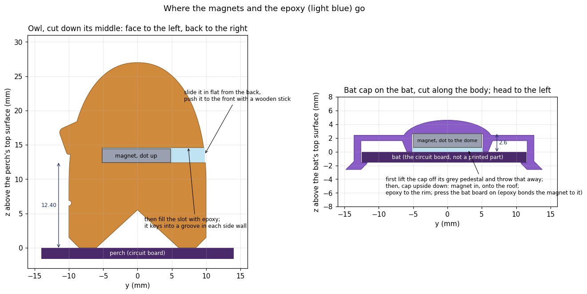

# The printed parts: an owl, the bat's cap, four feet

One plate, PLA, no supports, no pause, one STL. **Print `out/plate.stl`** ([through 3DPrinterOS](#printing-through-3dprinteros)) and epoxy the two magnets in afterwards ([below](#magnets-glue-them-in-after-printing)). For a reprint of one part, `out/owl.stl` or `out/bat_cap.stl`.

There used to be a second version that sealed the magnets in with a pause mid-print. It was removed on 2026-11-09, so that every STL here is one to print: the owl always has the slot in its back, and the cap's pocket has no floor.


## What you need

- About 13 g of PLA, any colour.
- Two 10 × 2 mm N52 disc magnets from the pack on the order list, and a felt-tip pen.
- Two-part epoxy (a slow-setting one, 5 minutes or more), a toothpick or syringe for it, and a **wooden or plastic** stick to push the owl's magnet in.
- Cyanoacrylate (superglue) for the bat cap's hooks.

## Printing through 3DPrinterOS

At cloud.3dprinteros.com:

1. *Add file*, and choose **`out/plate.stl`**.
2. Choose the printer (we use the Bambu Lab X1 Carbon) and **Bambu PLA Basic**, or any PLA.
3. Before you slice, change two of its defaults: **supports off** (it defaults to `tree(auto)`) and **brim none** (it defaults to `outer_only`). Supports would fill the spaces the grey stand-ins already fill, and a brim would glue the stand-ins' edges down.
4. Check the rest against "Print settings" below. 3DPrinterOS's X1C defaults already have them right: 0.2 mm layers, 2 walls, 15 % infill, the Textured PEI plate.
5. Slice and print. Letting it arrange the plate is fine: the whole plate is one STL, so it moves as one piece, and the owl and the cap stay 56 mm apart. **Don't let it rotate the plate or lay it flat.**

If slicing fails with `wall_filament: 0 not in range` (and the same for `sparse_infill_filament` and `solid_infill_filament`), the fault is in 3DPrinterOS's printer profile, not in the file. Ask the 3DPrinterOS administrator to fix it, and give them the job ID from the log.

## Print settings

- PLA, 0.4 mm nozzle, **0.2 mm layers with a 0.2 mm first layer**, 2 walls, 15 % infill, **supports off**, **no brim**. Bambu's "0.20mm Standard" is exactly this.
- Leave the parts the way they load: everything prints standing up, the way it is used. Don't use auto-orient. Arranging is fine as long as **the owl and the bat cap stay at least 4 cm apart** (their magnets would tug at each other; as placed they are 56 mm apart).
- A Bambu slicer warns: *"It seems object ... has floating cantilever. Please re-orient the object or enable support generation"*. **Ignore it; don't enable supports.** The owl's base and the cap's floor sit one layer above their grey stand-ins, the same 0.2 mm gap Bambu leaves above its own supports.
- Bambu Studio 2.8 estimates 32 min on an X1C or P1S, 37 min on an A1 or A1 mini, 12.9 g.

## After printing

1. Take the parts off the plate.
2. **Peel the grey slab off the owl's base**, starting at its front tab. **Lift the bat cap off its pedestal** with a little twist. Throw the slab and the pedestal away.
3. The undersides that sat on the stand-ins are a little rough. That's normal, and they don't show.

## Magnets: glue them in after printing

The plate prints straight through, with nothing to do mid-print. The owl's pocket opens out of its **back** (toward the tree) as a slot the magnet slides along, flat. The bat cap's pocket has **no floor**: its magnet goes in from below, and the bat closes the pocket when the cap goes on. Two-part epoxy fills what's left. The owl's magnet rests on its pocket floor, 12.45 mm above the perch's top copper, where its weight and the bat's pull hold it. The cap's magnet sits against the pocket's roof, where the floating bat's pull would put it anyway.



The roof over each empty pocket is a 10.5 mm bridge, which PLA spans easily. The owl's slot is snug: 2.2 mm tall and 10.25 mm wide for a 10 × 2 mm magnet (Jason, 2026-11-09: less epoxy, less mess). If the roof sags a little, push the magnet past it with the stick. (The photos in `parts.png` above are older renders, with a 2.6 mm slot and the magnet higher in the owl; the shape is otherwise the same.)

For pushing the owl's magnet in, use a **wooden or plastic** stick, such as a skewer or a toothpick. Don't use a screwdriver: the magnet would follow it back out.

**Magnets in** (do this before snapping the parts onto the boards):

1. Make sure the stand-ins are off ("After printing", above): the grey slab peeled off the owl's base, the bat cap lifted off its grey pedestal, both thrown away. In the picture above, "perch" and "bat" are the circuit boards, not printed parts.
2. Put the stack of magnets on the table. Mark a dot on the top face of the top magnet, then **slide it off sideways without turning it over**. Mark the new top magnet the same way and slide it off too. Put the rest of the stack well away (half a metre).
3. **Owl:** stand it upright. Slide one magnet, **dot up**, flat into the slot in its back, and push it in with the stick until it stops against the front of the pocket. Its back edge is then about 4 mm inside the owl. Fill the slot with epoxy to the owl's back surface, working it into the slot's two side grooves, which key the plug in. Leave the owl upright while it cures, so the magnet stays flat on its floor.
4. **Bat cap:** hold it **upside down** (dome down, pocket opening up). Drop the other magnet in, **dot down**, toward the dome. Upside down, that's the same as dot up when the cap is on the bat. It rests on the pocket's roof. Fill the rest of the pocket (about 0.6 mm) with epoxy, level with the rim.
5. While the epoxy is wet, press the bat board on: turn the bat **top face down**, line the cap's ears up with the bat's head, and press until both hooks click. Wipe off what squeezes out. Then glue the hooks with cyanoacrylate, as in "Assembly", step 3. The epoxy also bonds the magnet to the bat, so it's sealed in on every side.
6. Let the epoxy cure fully (see its package; give it a day) before you put the owl on the perch.

**Weight.** The glue doesn't change the float. The owl's glue doesn't matter: the owl is clipped to the perch. The bat's cap trades its 0.4 mm PLA floor (0.04 g) for up to about 0.07 g of epoxy round and under the magnet: about 0.03 g more on a 3.7 g bat, under 1 %. Even a sloppy 0.1 g extra moves the bat's float point only about 0.2 mm up (its weight over the magnets' 4.8 N/m force gradient, `sim/physics/levitation_onemagnet.py`), which the zero-power loop finds by itself. Wipe off the squeeze-out anyway.

**Check the polarity** once it's cured: hold the bat under the owl and it should be pulled up. If it's pushed away, one magnet went in upside down. Cured epoxy doesn't come out, so reprint that part. That's why it's worth checking before the glue goes in: a magnet dot up attracts another held above it dot up, the way the stack did.

**Child safety.** The cap's magnet is enclosed: plastic on top and sides, the bat underneath, the cap glued on. The owl's magnet is held by an epoxy plug about 4 mm deep, locked into the slot's grooves. The owl is too big to swallow. Don't use silicone here instead: it barely sticks to PLA, and a child could dig it out and free the magnet.

## Assembly

1. **Feet:** from underneath the base board, push each pumpkin's split peg up through a corner hole until the barb clicks over the top. The board rests on the pumpkin's flat top.
2. **Owl:** ideally before plugging the perch onto the tree, so you can hold the perch in your hand. Set the owl over the coil, **facing the front** (away from the tree socket), with its wings over the two notches in the perch's sides. Press straight down until both wings click under the board, or hook one wing under first and press the other side down. Its base sits flat on the coil.
3. **Bat cap: ears toward the bat's head.** Hook the head end under the head edge, then press the tail end down until it clicks under the tail edge. The hooks pull the cap down onto the bat (you do this in step 5 of "Magnets in", with the epoxy still wet). **Then glue it**: a drop of cyanoacrylate where each hook meets the board's edge, and let it set. The cap holds a 10 x 2 mm N52 magnet and is small enough to swallow; glued to the bat (48 x 25 mm) it is not a small part, and the magnet is sealed in anyway. (Review of 2026-10-09: a snap-on cap is not retention a child cannot defeat.)
4. To take the owl off, spread a wing outward with a fingernail and lift. The cap stays on.


## The parts

| part | what it does |
|---|---|
| **Owl** | Snaps onto the perch over the levitation coil. Holds the bias magnet with its bottom face **12.45 mm above the perch's top copper** (`OWL_LIFT` = 12.5, lowered from 14.0 on 2026-11-09 for the 4.7 g bat; the 0.2 mm layers set the 0.05). The magnet slides in through a slot in its back. Its wings come down the perch's sides into the two notches and hook 0.8 mm under the board, so it can't slide or tip. Its hollow base touches the coil only with a 2.5 mm rim. |
| **Bat cap** | The floating bat's round, eared body. Holds the bat's magnet on the bat's top over the receive coil, and hooks 0.8 mm under the bat's head and tail edges. No holes in the bat. Its pocket has no floor: the bat closes it. 0.45 g. |
| **Four feet** | Little pumpkins that snap into the base board's corner holes from below and lift it 6 mm, clear of the through-hole pins. |
| **Two grey stand-ins** | A slab under the owl and a pedestal under the cap: throw-away. They stand where the perch and the bat will be, so the parts' undersides can print upright with nothing to support them but the stand-ins. |


## Files (`out/`)

All the printable files are STLs. Each plate is one STL with all six objects already placed.

| file | use it for |
|---|---|
| **`plate.stl`** | **The one to print.** Owl, bat cap, four feet and the two stand-ins; no pause. The magnets go in after printing ([above](#magnets-glue-them-in-after-printing)). |
| `owl.stl`, `bat_cap.stl` | One part each, with its stand-in, for a reprint. |
| `foot.stl` | One foot, for a reprint. |
| `assembled/*.stl` | The bare owl and cap in their boards' coordinates, for checking them against the boards. Not for printing. |
| `*.png` | The pictures here. |

## Fit and strength


These numbers are re-measured from the meshes by `check.py` against `gen/mech.py` (`build.py` rewrites this block):

<!-- numbers: begin (build.py writes this block) -->
```
magnet bottom above the perch's top copper  12.45 mm  (OWL_LIFT 12.5; on the 0.2 mm layer grid)
no pause: both magnets go in after printing, glued with epoxy (magnet 10 x 2)
owl  slot 10.25 x 2.2 out through its back; 4.7 mm of epoxy behind the magnet
cap  no floor; pocket 10.35 across, magnet top 2.6 mm above the bat, against the roof
owl hooks  0.8 mm under the perch, slot 2.0 for a 1.6 board
cap hooks  0.8 under the head (y -12.5) and tail (y 11.5), slot 1.60
snap strains  owl wing-arm 1.0 %, cap arm 1.6 %, foot prong 1.6 %  (PLA: keep < 2 %)
cap preload  1.8 / 3.5 N per hook (arm stress 17 / 33 MPa) when the board is 0.1 / 0.2 mm thicker than the slot
cap mass  0.45 g of PLA (it prints solid; 1.24 g/cm3)
owl  30.1 mm tall above the perch; bat floats 10.1 mm below the perch (sim/physics)
overhangs  no floating islands; farthest unsupported spot owl 5.2 mm, bat cap 5.2 mm, foot 0.4 mm (the pockets' roofs are bridges)
```
<!-- numbers: end -->

- **Magnet position.** The owl's pocket floor is on the layer grid, 12.40 mm above its base: the magnet's bottom sits 12.45 mm above the top copper (within 0.1 mm of `OWL_LIFT`), centred over the coil within 0.2 mm once pushed to the pocket's front. As printed, the base is the bridged layer above the slab, so the owl may sit up to ~0.15 mm higher. The float gap moves 1:1 with it, which the zero-power loop absorbs.
- **Owl's hooks.** The lip catch is 2.0 mm below the base: 0.4 mm play on a 1.6 mm board, so a board at the +0.16 mm tolerance still snaps in. Gravity and the bat's pull keep the owl down on its base. The wing-arms are 1.0 mm plates, 11.6 mm from root to lip, and bend 0.9 mm to let the lips pass the notch bottoms, at about 5 N per wing; the peak strain is in the block above.
- **Cap's hooks.** The catch-to-floor slot equals the board, 1.6 mm. The floor is bridged over the pedestal, so it prints about 0.1 mm low and the arms preload the cap onto the bat by roughly 1 N per hook. That keeps the bat rigid when it floats. The arms are 0.8 mm bridges raised 1.6 mm above the bat; the longer lever keeps the snap strain under 2 % (block above).
- **Feet.** The barb catches 0.2 mm of the board's top face; the split prongs flex 0.25 mm to pass the hole.
- **Cap mass.** 0.45 g of PLA at 1.24 g/cm³. It prints solid (walls ≥ 0.85 mm, no room for infill), so "100 % infill" is the real assumption. The levitation sim assumed 0.4 g, for a 3.6 g bat; the bat as flown on 2026-11-09 weighed 4.70 g with its cap and magnet (`bringup/REVB.md` 1.11), and the loop's set-point follows `lev tune mass_g`.
- **Overhangs.** `check.py` slices each part the way a slicer does (every layer at its mid-height) and measures how far any new plastic lies from the layer below. Apart from the stand-in interfaces and the roofs over the empty pockets (bridges, 5.2 mm from either wall at their middle): no floating islands; the owl's next worst spot is 0.9 mm (a pupil's catch-light); the cap's arms are 6.5 mm bridges; everything else follows ≤ 45° slopes.
- **Real slicer.** On 2026-10-07 the plate (then the pause version) was sliced with Bambu Studio 2.8.2 as an X1C, P1S, A1 and A1 mini: 165 layers each; the only warnings were the two expected "floating cantilever" notes. The owl's base (layer 16), the cap's arms (92) and the pockets' roofs print as bridges; the cap's drops start as overhang walls on the pedestal (71). This plate has since been printed through 3DPrinterOS (`HANDOFF.md`).

## Safety

The cap's magnet is enclosed by plastic, the bat and epoxy, and the owl's is held by an epoxy plug locked into grooves (see the "Child safety" note above). The owl is too big to swallow. The bat cap is a small part with a magnet in it, so keep it glued onto the bat; the 48 mm bat is not a small part. Swallowed neodymium magnets are dangerous; a grown-up should handle spare magnets and do the gluing.

## For the board designer

- **Perch:** the wings' inner corners are chamfered 0.6 mm, so router fillets up to r 0.5 in the notches' inside corners are fine. The lips reach 0.8 mm under the board inside the 2 mm keep-out. On top, the owl covers |x| ≤ 15.5, y −11.6 … +10 (toes in front); nothing on the top side there except the coil. The thread hole at (0, −15.5) is clear.
- **Bat:** the head and tail edges must be straight across |x| ≤ 3 mm, where the lips hook. The cap's drops hang 0.1-2.3 mm outside those edges and 2.6 mm below the bat's top. On top, keep clear of the cap's dome (r ≤ 6.6 mm) and of the strips |x| ≤ 2.5 mm under its arms. The arms are 1.6 mm up, so parts under 1.4 mm tall may sit beneath them. The magnet's top face ends up 2.6 mm above the bat's top surface (the pocket has no floor; the magnet is glued against its roof, 2.6 mm up), not the 2.0 mm `sim/physics/bat_power.py` assumes.
- **Base:** each foot's top is 11 mm across: keep 5.5 mm round each foot hole clear on the bottom side.
- **Cap location (optional):** the cap's drops fix it front to back (0.1 mm clearance to the edges), but sideways it is held only by friction along the head and tail edges, with about 1 N of preload. To pin it sideways too, notch the head and tail edges 5.4 mm wide and 0.5 mm deep at x = 0, and make `BAT_HEAD_Y` and `BAT_TAIL_Y` in `mech.py` the notch bottoms; `build.py` then remakes the cap with its 5 mm drops sitting in the notches.

## How it's made

```sh
python3 print/build.py       # everything below, ~1 minute; --no-render skips the pictures
python3 print/check.py       # re-measure the meshes against gen/mech.py (exits non-zero on a failure)
```

- `design.py`: every number. It reads `gen/mech.py` (the boards, the magnet, the pockets, `OWL_LIFT`, the notches, the bat's edges, the foot holes) and adds only printing numbers.
- `owlternating.scad`: the OpenSCAD models. All their numbers come from `out/params.scad`, and the owl's body and wing hulls from `out/shapes.scad`, both written by `build.py`.
- `build.py`: runs OpenSCAD, writes the STLs, draws the pictures, runs `check.py` and fills in the numbers above.
- `check.py`: measures the meshes by ray casting and slicing, without trusting `design.py`'s claims.
- `meshtools.py`: STL I/O, slicing, ray casting.

Needs OpenSCAD 2021.01 or later, and Python 3 with numpy, scipy, shapely, matplotlib and Pillow.
