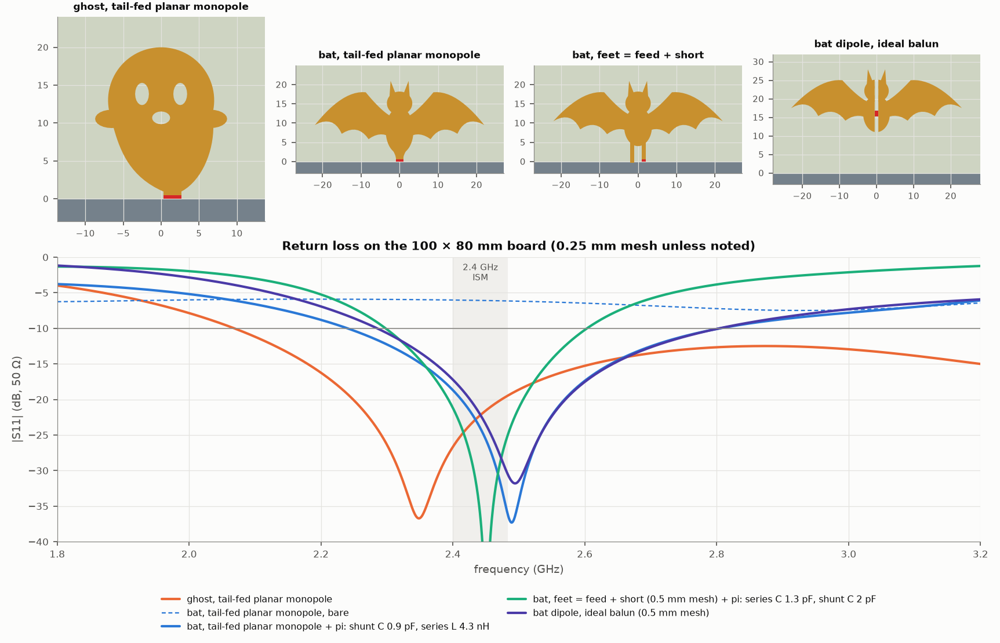
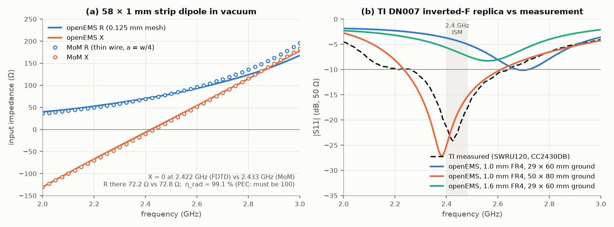
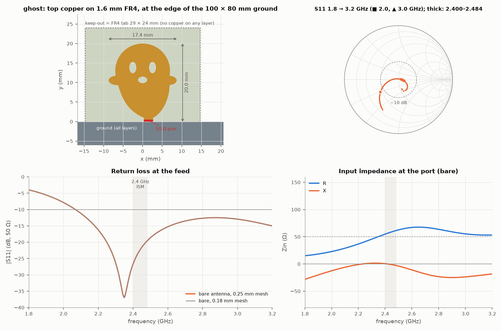
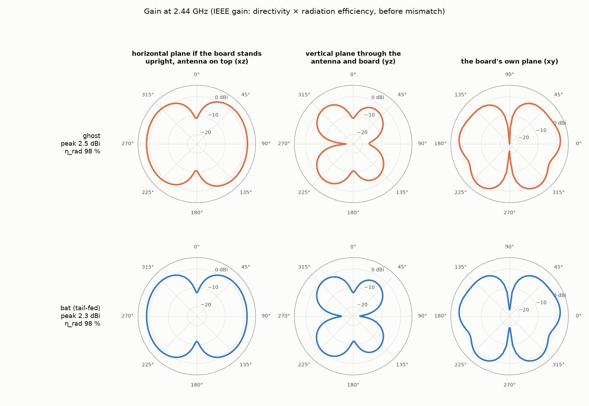
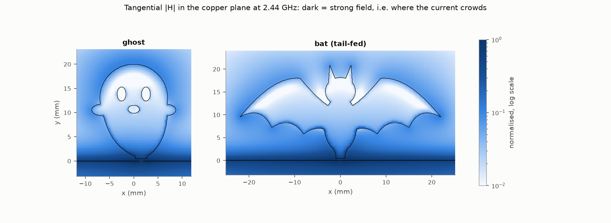
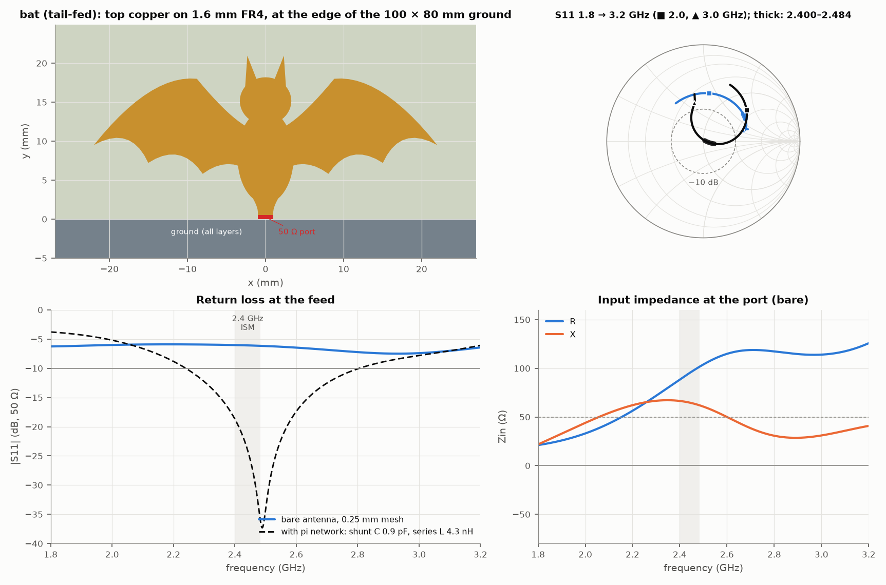
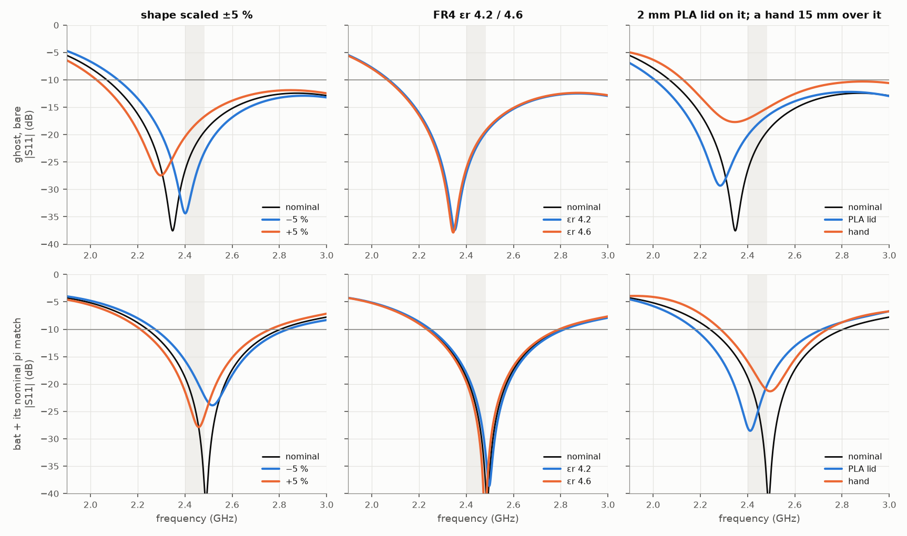

# A 2.4 GHz antenna shaped like a Halloween character: feasibility study

*openEMS FDTD study for the halloween1 board, October 2026.*

**Verdict: yes, and the ghost is the one to build.** A cartoon ghost works as a planar
monopole with no extra parts. It's 17 × 20 mm of top copper on bare 1.6 mm JLCPCB FR4,
fed from the ground-plane edge through its tail. In simulation it covers 2.400–2.484 GHz
at **−19.5 dB worst case**, its −10 dB band runs from **2.07 GHz to beyond 3.2 GHz**,
radiation efficiency is **98 %** and peak gain is **2.5 dBi**. Because it's so broadband,
±5 % artwork scaling, FR4 εr 4.2–4.6, a 2 mm PLA lid and a hand nearby leave it inside
−10 dB with margin (§7).

**A bat with outstretched wings works too, but not on its own.** Every way of feeding a
full-size bat from the board edge leaves it about 60–90 Ω inductive at 2.44 GHz. It's
one of two things: electrically too big (resonant near 1.5 GHz), or fed through its legs,
which act as an inductor. The fix is cheap: populate two parts in the pi network Espressif
asks you to reserve anyway (0.9 pF shunt at the antenna, 4.3 nH series). The tail-fed bat
is then matched over 2.24–2.81 GHz. It does depend on those two parts, so it wants one
NanoVNA session.

|  | **ghost** (recommended) | **bat**, tail-fed, + 2-part pi | bat as a dipole + balun | TI DN007 IFA copied onto this board |
|---|---|---|---|---|
| worst \|S11\| in 2.400–2.484 GHz | **−19.5 dB**, no parts | −18.7 dB matched (−6 dB bare) | −17 dB (ideal balun at the body) | −8.6 dB (fails) |
| −10 dB band | 2.07 → >3.2 GHz | 2.24–2.81 GHz (matched) | 2.29–2.80 GHz | 2.19–2.44 GHz |
| radiation efficiency | 98 % | 98 % | 96 % | 94 % |
| peak gain at 2.44 GHz | 2.5 dBi | 2.4 dBi | 5.1 dBi | 3.3 dBi |
| parts beyond the pi footprints | none | 0.9 pF + 4.3 nH (0402) | balun (4 LC parts or a ceramic one) + a feeder fix | needs retuning |
| copper size | 17 × 20 mm | 44 × 21 mm | 46 × 17 mm, 11 mm above the ground edge | 26 × 7 mm |

*Numbers are on the 0.25 mm production mesh, except the bat dipole, which is from the
0.5 mm scan. Efficiency is P_radiated / P_accepted at the port, with FR4 loss
(tan δ 0.02) included. Gain is IEEE gain (directivity × efficiency) before mismatch.*



---

## 1. The question

Can a character-shaped printed antenna on an ordinary JLCPCB FR4 board do 2.4 GHz
WiFi/BLE for an ESP32-C3/C6/S3? The radio's RF pin, after Espressif's recommended
matching, is single-ended 50 Ω, and the target is S11 < −10 dB across 2.400–2.484 GHz
with reasonable efficiency. Which topology works best, and how much tuning margin is
there?

The board assumed throughout: 1.6 mm FR4 (εr 4.4, tan δ 0.02). It's either 2-layer or
JLC04161H-7628 4-layer; with every copper layer cleared under the antenna they're the same
model. The rest of the board is a 100 × 80 mm via-stitched ground. The antenna sits on a
bare-FR4 tab in the middle of the 100 mm edge.

## 2. How it was simulated

* **Solver.** openEMS 0.37 (3D FDTD) via its Python bindings, using CSXCAD 0.7. The
  idioms (graded meshes, many small solves instead of one big one, a model revision in
  every cache key, rasteriser checks) come from
  `~/OpticsPCBs/SyzygyRadioDrivers/SMABridgeTestAnalysis/FIELD_SOLVER.md`.
* **Board.** The ground region is one PEC block spanning the board thickness. That's the
  limit of a top pour plus bottom (and inner) planes stitched by vias at ≪ λ/10, which
  is how it must be built. FR4 fills a tab above the ground edge with no copper on any
  layer. The antenna is on the top surface.
* **Copper** is a zero-thickness PEC sheet. 35 µm is 1/7 of the 0.25 mm cell and
  1/3500 of a wavelength. Its only first-order effect is a little extra edge
  capacitance on narrow traces; the finalists' narrowest copper is a 2 mm feed. Conductor
  loss was measured separately by re-running each finalist with the copper as a
  35 µm, 5.8 × 10⁷ S/m conducting sheet (§7).
* **Feed.** A 50 Ω lumped port in the copper plane bridges a 0.5 mm gap between the
  ground edge and the antenna's feed. That plane is the antenna's reference plane:
  where the CPWG/microstrip from the ESP32's matching network, and the antenna-side pi
  network, would connect.
* **Mesh.** The production mesh is a uniform 0.25 mm over the antenna plus 4 mm around
  it, 2 mm over the ground plane and ≤ 4 mm (λ/25) in air, graded at ≤ 1.3. There are 5
  cells through the FR4, graded out into the air rather than stepped. The topology scans
  used 0.5 mm; convergence is in §3 and §7.
* **Boundaries.** An 8-cell PML, 55 mm from the structure, leaving about 23 mm of clear
  air.
* **Excitation.** A Gaussian pulse covering 1.5–3.5 GHz, run until the energy has
  decayed by 50 dB.
* **Far field.** A frequency-domain NF2FF box at 2.40 / 2.44 / 2.48 GHz on a 2° × 4°
  grid. Radiation efficiency = P_rad (NF2FF) / P_accepted (port).
* **What the solver actually built.** The rasterised PEC edges were dumped
  (`--debug-PEC`) and drawn over the intended copper for every topology. Feet bond to the
  ground, feeds are isolated, and the ghost's keyhole-cut eyes are clean holes
  (`figs/pec_*.png`).
* **Matching networks** are evaluated in post-processing at the port plane
  (`matching.py`). They use real 0402 values, inductor Q = 40 and capacitor Q = 200.
  This is exact for parts placed at the feed.

## 3. Is the set-up right? Validation



**(a) An answer that can't be wrong.** A 58 × 1 mm strip dipole in vacuum, compared with
an independent thin-wire method-of-moments solve (`mom_dipole.py`, equivalent radius
a = w/4):

| | X = 0 resonance | R there | η_rad (PEC in vacuum: must be 100 %) |
|---|---:|---:|---:|
| openEMS, 0.5 mm mesh | 2.401 GHz | 72.3 Ω | 99.0 % |
| openEMS, 0.25 mm mesh | 2.415 GHz | 72.3 Ω | 99.1 % |
| openEMS, 0.125 mm mesh | 2.422 GHz | 72.2 Ω | 99.1 % |
| MoM, 61 / 121 segments | 2.435 / 2.433 GHz | 72.4 / 72.8 Ω | — |

The FDTD converges at first order, from the strip-edge singularity, towards about
2.429 GHz: 0.2 % from the MoM. At the 0.25 mm production mesh it reads **0.7 % low**: a
known bias to keep in mind when reading any frequency in this document. The power
bookkeeping closes to within 1 %.

**(b) Against a measured board.** TI's DN007 inverted-F (SWRU120D Table 1-1) was copied
to the letter onto 1.0 mm FR4. TI's measured curve was digitised from their Fig. 2-8
(`results/dn007_measured_s11_digitized.csv`).

| | S11 minimum | −10 dB band |
|---|---|---|
| TI, measured on CC2430DB | −24.1 dB at 2.425 GHz | 2.26–2.635 GHz |
| openEMS, 50 × 80 mm ground | −27.1 dB at 2.382 GHz | 2.234–2.611 GHz |
| openEMS, 29 × 60 mm ground | −10.1 dB at 2.697 GHz | 2.68–2.72 GHz |
| same, 0.18 mm mesh | −10.2 dB at 2.685 GHz | — |

The CC2430DB ground plane isn't documented. With a plausible 50 × 80 mm ground, the
simulation reproduces the measured curve's shape, depth and **375 MHz bandwidth**, and sits
**1.8 % low** in frequency. That's consistent with the 0.7 % mesh bias above plus FR4 a
little below 4.4. The 29 × 60 mm row is the lesson of the whole study: **the same
antenna moved 13 % when only its ground plane changed.** A PCB antenna's tuning belongs
to the board it's on, not to the antenna drawing. Board thickness matters too: on 1.6 mm
FR4 the same DN007 runs 5 % lower than on 1.0 mm. Copied as-is onto this
board (1.6 mm, 100 × 80 mm) it resonates at 2.30 GHz and **fails the top of the band
(−8.6 dB worst)**. Every printed antenna here needs a re-check against the final outline,
the character ones included.

## 4. What was tried, and why the bat needed help

Everything below is on the 100 × 80 mm board with a 0.5 mm mesh. The full table, with the
pi network each case would need, is in `results/exploration_table.md`.

| topology | best case | worst \|S11\| in band, bare | Z(2.44 GHz) | what is going on |
|---|---|---:|---:|---|
| **bat, feet = feed + short** (T-shaped IFA: one foot fed, one soldered to ground) | span 36–52 mm | −1 to −2 dB | 8–14 + j73 Ω | The scalloped wings are electrically long, so the bat resonates near **1.5 GHz**. At 2.44 GHz the port sees the small feed/short loop (~4.7 nH). Shrinking to 0.62× doesn't fix it. |
| **bat dipole**, balanced port at the body | span 46 mm | **−17.2 dB** | 43 + j2 Ω | The bat's natural mode: fat, flat, 2.29–2.80 GHz, 5.1 dBi (the ground edge is a reflector). Needs a balun, and the balun must sit at the body. |
| bat dipole fed up its legs (two-wire feeder, balanced or single-ended) | span 50 mm | −3.6 dB | 54–61 + j86–92 Ω | The 6 mm leg pair is a ~130 Ω twin-lead: about +75 Ω of series reactance pushes resonance to ~2.9 GHz. Shorter legs trade reactance for resistance. |
| **bat, tail-fed planar monopole** (no legs; the pointed lower body sits on a 2 mm feed) | span 44 mm | −6.0 dB | 96 + j66 Ω | A planar monopole, like the ghost, but its broad wings put the input at ~100 Ω and inductive. **Two parts match it over 2.24–2.80 GHz** (§6). |
| **ghost** (teardrop planar monopole) | R = 7 mm | **−19.1 dB** | 59 − j1 Ω | Tuned from 79 + j20 Ω (−11 dB) by shortening the feed stub to nothing, widening it to 2.4 mm, flattening the bottom and shrinking the head from 8 to 7 mm. |

Why the ghost and not the bat: a planar monopole is broadband when its body flares
smoothly away from the feed and every current path is short and direct. A ghost *is*
that shape. A bat's wings put most of its copper far out to the sides, where opposed
currents cancel in the far field and add reactance at the feed.

## 5. The recommendation: the ghost



**Geometry** (all top copper; the generator is `shapes.ghost()`, with its parameters in
`run_candidates.GHOST`):

* **Head.** A circle of radius 7.0 mm centred 13.0 mm above the ground edge (top at
  20.0 mm). It flares into a teardrop body whose flanks meet at a tail point 1.5 mm
  right of centre (the tail "swish").
* **Feed.** The tail point lands on a **2.4 mm wide feed** whose end is **0.5 mm from
  the ground-pour edge**. That 0.5 mm is the port gap. In KiCad, the RF trace from the pi
  network crosses the pour edge and widens to 2.4 mm under the tail. Up to the pour edge
  the line is ordinary 50 Ω. On the JLC04161H-7628 4-layer stack that's a microstrip
  over L2 (about 0.35 mm wide). On 2-layer 1.6 mm it's a via-fenced coplanar waveguide
  (about 1 mm wide with 0.15–0.2 mm gaps). Take the exact width from JLCPCB's impedance
  calculator.
* **Arms.** Two 4.4 × 2.4 mm elliptical stubs at mid-height, making it 17.4 mm wide
  overall.
* **Face.** The eyes (1.8 × 2.9 mm) and the mouth (2.4 × 1.7 mm) are holes in the
  copper. They sit in a low-current region (§5, field map), so they cost little, and they
  are in the simulated design. FR4 is translucent, so light from behind will show through
  them; keep the light source itself outside the keep-out.
* **Keep-out.** No copper on any layer in a **29 × 24 mm** region around it (the FR4
  tab). Keep components, batteries, screws and cables at least 5 mm further away.
  Stitch the ground pour along the ground edge with vias every ≤ 3 mm.

**Performance** (0.25 mm mesh; the 0.18 mm and 0.35 mm meshes agree within 0.1 dB and
1 MHz, §7):

| | |
|---|---|
| \|S11\| minimum | −36.7 dB at 2.348 GHz |
| worst \|S11\|, 2.400–2.484 GHz | **−19.5 dB** (VSWR 1.24) |
| −10 dB band | **2.07 GHz → beyond 3.2 GHz** |
| Zin at 2.44 GHz | 58 − j1 Ω |
| radiation efficiency (FR4 loss, PEC copper) | 98.2 % |
| copper loss on top of that | < 0.1 % (98.2 % with PEC, 98.2 % with 35 µm copper) |
| peak gain at 2.44 GHz | 2.5 dBi |
| total efficiency at band edges (η_rad × mismatch) | 98.1 % / 97.6 % / 97.1 % at 2.40 / 2.44 / 2.48 GHz (≤ 0.13 dB) |



The pattern is a doughnut around the antenna's own axis, like a vertical dipole when the
board stands upright with the ghost on top. There are nulls straight up and down. In the
horizontal plane (left column) the gain stays within about 2 dB of its +1.9 dBi peak over
most of the circle. The exceptions are two narrow (±20°) dips, to about −11 dBi, straight
out of the board's front and back faces. The 80 mm ground carries a current reversal
(it's 0.65 λ long), and that cancels the broadside radiation. Practical upshot: face the
board's *edge*, not its face, toward the router. The bat's pattern is almost identical,
because in both cases the board is doing much of the radiating.



The field map confirms the mechanism. The strongest fields run along the whole ground
edge on either side of the feed, around the tail and up the flanks: the ground plane is
half the antenna. The eyes, the bat's head and the wing interiors sit in quiet regions,
which is why holes and cosmetic detail there are cheap. (The quantity mapped is
tangential |H| in the copper plane. Over the ground block that equals the surface current. Over the thin
antenna sheet it averages the fields just above and below, so it understates the
antenna's own current, especially mid-sheet. Read it for *where* the current crowds, not
for ground-versus-antenna magnitudes.)

## 6. If it has to be a bat



The best bat is the **tail-fed planar monopole**. It's the full 44 mm-span bat with
scalloped wings and ears and no legs. The lower body tapers to a point that lands on a
2 mm feed, 0.5 mm from the ground edge (`shapes.bat("pm", span=44, yb=8, bh=6)`, keep-out
56 × 25 mm). Bare, it presents 95 + j65 Ω at 2.44 GHz (−6 dB). Adding a **0.9 pF shunt
capacitor at the antenna side and a 4.3 nH series inductor**, both 0402 in the pi
footprint, gives:

| | 0.25 mm mesh |
|---|---|
| worst \|S11\| in band, matched | −18.7 dB |
| −10 dB band, matched | 2.24–2.81 GHz |
| loss in the two parts (Q_L 40) | ≈ 0.2 dB |
| radiation efficiency / peak gain | 97.6 % / 2.35 dBi; total efficiency (× mismatch × network loss) 93 % |

The match is reasonably robust. A ±0.1 pF error on the shunt capacitor leaves the band
at −13.5 dB or better. Every sensitivity case in §7, evaluated with the *nominal* parts,
stays at −15.7 dB or better. The cost is that it depends on two components and their
pads. Budget one NanoVNA session (§8) rather than trusting the simulated values to
±0.1 pF.

An even broader match exists (a 15 nH shunt inductor with a 1.0 pF series cap is matched
from 2.19 GHz to beyond 3.2 GHz in the ideal-part calculation). It was rejected: a 15 nH
0402 inductor self-resonates near 3 GHz, so at 2.44 GHz its effective value is far from
nominal. `matching.py` only offers networks with inductors ≤ 10 nH.

**Why not the classic "bat hangs from the board by its feet" IFA?** That's the first
design tried and the cutest. It *can* be matched (a 1.3 pF series, 2 pF shunt pi gives
−21 dB over 2.30–2.60 GHz, 0.5 mm mesh). But its matched band is about half the tail-fed
bat's, and its 14 Ω input needs a 3.6 : 1 impedance step. That step magnifies pad
parasitics, part tolerance (±0.1 pF → −12.6 dB) and the parts' own loss.

**The dipole bat and its balun.** Fed in the middle of its body, the bat is a superb
dipole: −17 dB bare across the band, 2.29–2.80 GHz, 5.1 dBi. The ESP32 output is
single-ended, so it needs a balun. Two options:

* a lumped lattice balun: 50 Ω unbalanced to 50 Ω balanced, L = 3.3 nH, C = 1.3 pF,
  two of each;
* a ceramic 2.45 GHz balun from the Johanson 2450BL15B… family (pick the 50 Ω
  balanced version), about 0.5 dB loss.

The catch is *where* the balun goes. It has to sit at the bat's body, or a balanced
feeder has to run from the board edge to the body. The bat's legs make exactly such a
feeder, and they add about +75 Ω (§4), which then needs its own series capacitor. So the
dipole route costs a balun *and* a match, for about 2.7 dB more peak gain than the
tail-fed bat. That only matters if range is marginal.

## 7. Sensitivity: how much margin is there?



**Ghost, bare (0.35 mm mesh; the differences are what count):**

| variant | worst in band (dB) | −10 dB band (GHz) | f(S11 min) shift | η_rad | gain (dBi) |
|---|---:|---:|---:|---:|---:|
| nominal | -19.4 | 2.07–>3.2 | +0.0 % | 98.2 % | 2.54 |
| shape −5 % | -23.2 | 2.12–>3.2 | +2.3 % | 98.2 % | 2.57 |
| shape +5 % | -16.7 | 2.03–>3.2 | -2.2 % | 98.2 % | 2.51 |
| FR4 εr 4.2 | -19.6 | 2.07–>3.2 | +0.1 % | 98.3 % | 2.55 |
| FR4 εr 4.6 | -19.2 | 2.07–>3.2 | -0.1 % | 98.2 % | 2.53 |
| 2 mm PLA lid on the copper | -16.6 | 2.01–>3.2 | -2.7 % | 97.8 % | 2.49 |
| tissue block 15 mm over it | -15.1 | 2.13–>3.2 | -0.1 % | 56.2 % | 2.70 |
| copper loss (35 µm Cu sheet) | -19.4 | 2.07–>3.2 | +0.0 % | 98.2 % | 2.54 |
| mesh 0.18 mm | -19.5 | 2.07–>3.2 | +0.0 % | 98.2 % | 2.54 |

**Tail-fed bat, through its nominal 0.9 pF + 4.3 nH match (0.5 mm mesh):**

| variant | worst in band (dB) | −10 dB band (GHz) | f(S11 min) shift | η_rad | gain (dBi) |
|---|---:|---:|---:|---:|---:|
| nominal | -18.7 | 2.24–2.80 | +0.0 % | 97.7 % | 2.35 |
| shape −5 % | -15.7 | 2.27–2.84 | +1.1 % | 97.7 % | 2.39 |
| shape +5 % | -21.4 | 2.21–2.76 | -1.2 % | 97.6 % | 2.30 |
| FR4 εr 4.2 | -17.9 | 2.25–2.82 | +0.4 % | 97.7 % | 2.36 |
| FR4 εr 4.6 | -19.6 | 2.23–2.79 | -0.4 % | 97.6 % | 2.34 |
| 2 mm PLA lid on the copper | -20.2 | 2.18–2.71 | -3.1 % | 97.0 % | 2.22 |
| tissue block 15 mm over it | -15.9 | 2.29–2.74 | +0.3 % | 56.9 % | 2.45 |
| copper loss (35 µm Cu sheet) | -18.8 | 2.24–2.80 | +0.0 % | 97.6 % | 2.35 |
| mesh 0.35 mm | -18.7 | 2.24–2.81 | +0.0 % | 97.6 % | 2.35 |

What the tables say:

* **±5 % on the shape** moves the ghost's S11 minimum by ±2.3 %. Its −10 dB band starts
  at 2.03–2.12 GHz, so the band of interest never gets near an edge.
* **FR4 εr 4.2 vs 4.6** moves either antenna by less than ±1 %. With no ground under the
  copper, most of the field is in air: the board is a weak load, not the resonator.
  This is the main reason a bare-FR4 tab is a good place for an antenna.
* **A 2 mm PLA lid lying on the copper** is the biggest *detuning* tested: about −3 %
  in frequency. The ghost absorbs it (−16.6 dB worst in band, minimum 2.7 % lower). The
  matched bat actually improves (−20.2 dB), because its matched band sits a little high.
  A lid with an air gap of a few millimetres would do much less.
* **A hand** (a 20 mm tissue slab, εr 40, σ 1.5 S/m, 15 mm over the board) hardly
  detunes either antenna. The ghost holds −15.1 dB in band and the matched bat −15.9 dB.
  But it absorbs about 42 % of the power: radiation efficiency falls from 98 % to 56–57 %
  (−2.4 dB). That's the range penalty any handheld radio lives with, not a design flaw.
* **Copper loss** (35 µm Cu instead of PEC) costs under 0.1 percentage point for
  either finalist (ghost 98.2 → 98.2 %, bat 97.7 → 97.6 %). These are wide planar
  antennas with low current density. FR4's tan δ 0.02 costs about 1–2 % (the NF2FF
  bookkeeping itself reads about 1 % low, §3a), and that loss is already in every
  efficiency figure.
* **Mesh.** The ghost at 0.5 / 0.35 / 0.25 / 0.18 mm reads −19.1 / −19.4 / −19.5 /
  −19.5 dB worst-in-band, with its minimum at 2.342 / 2.348 / 2.348 / 2.349 GHz. The
  bat's bare impedance at 0.5 / 0.35 / 0.25 mm is 95.6 / 96.2 / 94.9 + j65.7 / 66.8 /
  64.8 Ω. Broadband antennas converge fast; the validation dipole's
  0.7 % low bias at 0.25 mm is the honest error bar on any frequency quoted here.

## 8. The pi network and the bench tuning plan

**Lay out the pi network whatever you build.** Espressif's hardware guidelines reserve a
pi network (C – L/C – C) at the antenna feed. Put three 0402 footprints within 2–3 mm of
the ground edge, on the 50 Ω line just before it crosses into the keep-out:

| | antenna-side shunt | series | chip-side shunt |
|---|---|---|---|
| ghost (start) | DNP | 0 Ω | DNP |
| tail-fed bat (start) | 0.9 pF | 4.3 nH | DNP |

With a NanoVNA (V2 or H4: 2.4 GHz is well inside its range):

1. **Isolate the antenna.** Leave the series pad of the *chip's own* RF matching
   unpopulated, or lift it, so only the antenna and its pi network are on the line. Solder
   a short semi-rigid or 1.13 mm coax pigtail: shield to the ground pour right at the
   feed, centre to the pi network's chip side. A u.FL footprint there makes this
   painless.
2. **Calibrate** SOL at the pigtail's end, or calibrate at the connector and set
   electrical delay until an open pigtail sits on a point of the Smith chart.
3. **Measure the board as it will live.** Batteries in, any lid on, standing in its
   stand. Put a clip-on ferrite on the coax a few centimetres from the board and route
   the cable straight away from the antenna. TI notes that on small boards the cable
   alone moves an IFA by 5–10 MHz and 3–4 dB.
4. **Read Z at 2.442 GHz** and put it through `matching.py` (or any Smith chart tool)
   to get the two-element L-network. Populate the nearest 0402 values and re-measure. One
   iteration is normally enough; the ghost should need none.
5. **Pass criteria:** |S11| < −10 dB from 2.400 to 2.484 GHz with the lid on. Then
   restore the chip-side link and check the ESP32's reported RSSI from a phone or AP
   at a few metres against a known-good dev board.

## 9. Caveats

* **The ground plane is part of the antenna.** Everything here is for a solid 100 × 80
  mm ground with the antenna centred on the long edge. DN007 moved 13 % between two
  ground sizes. A pumpkin-shaped outline, a cut-out or a large unstitched area will shift
  the bat more than the ghost, but re-run `run_candidates.py` with the real outline
  (`standard_board()` takes the ground rectangle) or rely on the pi network.
* **FR4** εr and tan δ are JLCPCB's nominal values, good to perhaps ±5 %. The
  sensitivity runs bracket that.
* **Not modelled:**
  * solder mask (20–30 µm LPI typically lowers f by 0.5–1.5 %, far less than the PLA
    lid that was modelled);
  * the ESP32 module, LEDs, battery and wiring;
  * the 0402 pad parasitics, about 0.1–0.2 pF each, which is what the bench step is for;
  * the transition from the 50 Ω trace to the antenna. The lumped port is an idealised
    feed; a real CPWG adds a short, known phase rotation that the pi network absorbs.
* **The matched bat's numbers are post-processed** with ideal two-terminal parts of the
  stated Q. The 4.3 nH inductor's self-resonance is well above 6 GHz, so its 2.44 GHz
  value is within a few percent of nominal. The pads add about 0.1–0.2 pF to each shunt
  position; the first NanoVNA pass absorbs that.
* **Mesh/solver error.** About 0.7 % low in frequency at 0.25 mm (§3a), and 1.8 % low
  against TI's measurement (§3b). Both are small next to the ghost's bandwidth and inside
  the matched bat's. No second full-wave solver (EMerge) was run; the method-of-moments
  dipole and TI's measured board play that role.

## 10. Will it work first time?

* **Ghost: ~85–90 %** chance of |S11| < −10 dB across the band straight off the first
  JLCPCB batch, and ~98 % after one NanoVNA session with the pi network. The residual risk
  is the board outline and whatever ends up within 5 mm of it, not the antenna.
* **Tail-fed bat with the simulated parts: ~70 %**, and ~95 % after one tuning
  iteration. Its matched band is wide, but it rests on two small parts and their pads.
* **The feet-fed (IFA) bat or the dipole bat:** don't build these first time. They work
  on paper only with a narrower match or a balun-plus-feeder, respectively.

## 11. Files and how to reproduce

| file | what |
|---|---|
| `antsim.py` | the openEMS model builder, runner, cache (`out/<case>_<hash>/`) and post-processing (S11, Zin, NF2FF, efficiency) |
| `shapes.py` | parametric geometry: free-space dipole, TI DN007, the bat (`ifa`, `dipole`, `split_ifa`, `legfed`, `pm`), the ghost |
| `mom_dipole.py` | independent thin-wire MoM reference for the validation dipole |
| `matching.py` | L/pi network synthesis on real 0402 values, matched S11, network loss |
| `runner.py` | many small openEMS solves in parallel (FDTD here is memory-bandwidth bound) |
| `run_validation.py` | §3: dipole vs MoM, DN007 vs TI |
| `run_candidates.py` | §4–6: stages A, B, B2–B5 (0.5 mm scans), C* (0.25 mm production) |
| `run_sensitivity.py` | §7: `ghost` and `bat` (scale, εr, PLA, hand, copper loss, mesh) |
| `analyze.py`, `make_figs.py` | the tables and figures in this file, from cached results only |
| `view_geom.py` | geometry previews and the rasterised-PEC overlays (`figs/pec_*.png`) |
| `results/*.json` | one small summary per solved case; `validation.csv`, `exploration_table.md` |
| `figs/` | everything shown above |
| `out/` | openEMS run directories with probe and NF2FF data (gitignored, regenerable) |

```
cd sim/antenna
NPAR=6 em-env python run_validation.py           # ~30 min on the 16-core box
NPAR=6 THREADS=4 em-env python run_candidates.py A    # then B, B2 ... B5, Cg, Cpm, Cbat
NPAR=4 THREADS=3 em-env python run_sensitivity.py ghost   # and: bat
em-env python make_figs.py                       # all figures
printf "C_ghost\nC_bat_pm\n" | em-env python analyze.py   # tables
```

Compute used: 58 solved cases, about 7 job-hours of solver time run 4–12 at a time, so
roughly 2 hours of wall-clock on the 16-core Ryzen 7950X. The machine is
memory-bandwidth bound at about 140 MC/s however the work is split, so wall time ≈ total
cell-updates / 1.4 × 10⁸. A 0.5 mm scan case takes 2–8 minutes; a 0.25 mm production
case takes 15–20.
